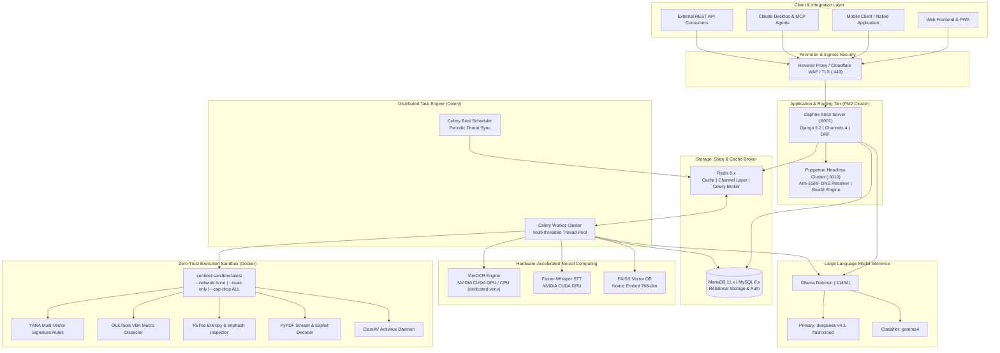
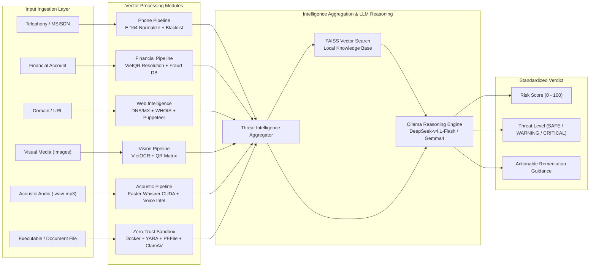
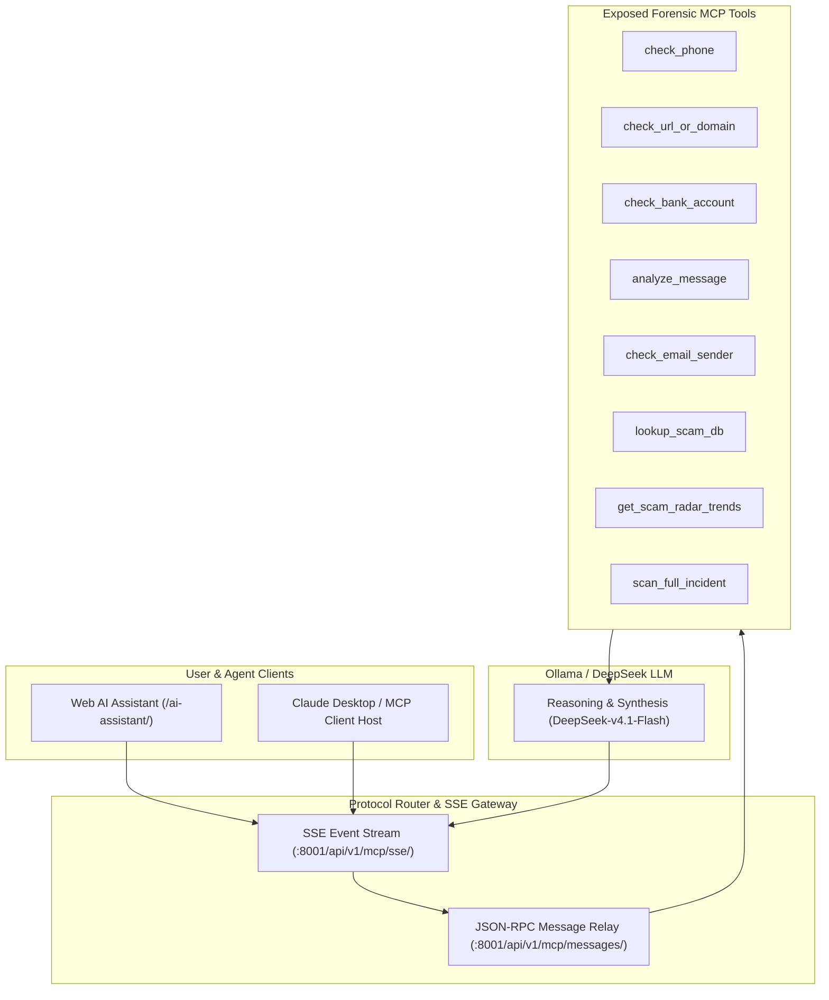

<div align="center">
 <h1>ShieldCall VN (Sentinel Core)</h1>
 <p><b>Advanced Multi-Modal Threat Intelligence, Zero-Trust Sandbox & Anti-Fraud Architecture</b></p>
 <p><b>Live Demo:</b> <a href="https://sc.fptoj.com">https://sc.fptoj.com</a></p>

 [](https://www.python.org/)
 [](https://www.djangoproject.com/)
 [](https://mariadb.org/)
 [](https://redis.io/)
 [-purple.svg)](https://ollama.com/)
 [](https://www.docker.com/)
 [](https://developer.nvidia.com/cuda-zone)
 [](https://pm2.keymetrics.io/)
</div>

---

## 0. Repository Layout

```text
Sentinel_Team_Project/
├── backend/ # Django 5.2.5 Core (PKV, api, manage.py, vector_store, scripts, sandbox)
├── frontend/ # Next.js 16.4.0 App Router UI (app, src, public)
├── puppeteer_host/ # Standalone Headless Browser (TypeScript strict, multi-layer SSRF defense)
├── docs/ # Technical specifications, defense papers, architecture guides
├── ecosystem.config.js # PM2 process manager configuration (orchestrates 5 microservices)
├── README.md # System documentation & deployment guide
└── _minhchung/ # Evaluation committee dossier & test logs (gitignored)
```

> Backend commands run from within `backend/` (e.g., `cd backend && python manage.py check`).
> Frontend commands run from within `frontend/` (e.g., `cd frontend && npx tsc --noEmit`).
> Puppeteer commands run from within `puppeteer_host/` (e.g., `cd puppeteer_host && npm test`).

---

## 0.1 Recent Updates: Evaluation Committee Enhancements (2026-10-15)

Five core architectural improvements addressing evaluation committee recommendations (detailed verification dossier: [`docs/CAI_TIEN_THEO_HOI_DONG.md`](docs/CAI_TIEN_THEO_HOI_DONG.md)):

1. **Uncertainty Guardrail**: When evidence is inconclusive (risk score 10-39 without independent confirmation), the system **NEVER concludes "safe"**. Instead, it assigns the label *"INSUFFICIENT EVIDENCE FOR VERIFICATION"*, accompanied by explicit disclaimers and verified official verification hotlines.
2. **Evidence-Backed Findings**: Every analysis output includes structured `evidence[]` entries (source identifier, reliability tier, severity rating, and reference links).
3. **Transparent Source Telemetry & Tool Limitations**: Comprehensive source catalog exposed via `/api/v1/trust/sources/` detailing reliability metrics and explicit operational boundaries for each engine (including LLM hallucination constraints).
4. **Domestic Vietnamese Threat Intelligence**: Integration of official national hotlines (NCSC 156, Police 113, VNCERT), 18 commercial bank/e-wallet emergency lines, and Vietnamese scam vocabulary dictionaries (`/api/v1/trust/channels/`). A crawler library for the official **Tín nhiệm mạng** directory (`tinnhiemmang.vn`) ingests certified trusted websites plus the reported-scam domain list into the trusted-domain map and the `tinnhiem_fake` threat feed ([`docs/TINNHIEM.md`](docs/TINNHIEM.md), robots.txt-respecting by default).
5. **Data Protection & PII Redaction**: Automated sanitization of sensitive personal data (phone numbers, email addresses, bank accounts, citizen IDs, payment cards, secret keys) prior to logging or cloud LLM transmission (`/api/v1/trust/privacy/`).

> **Limitations & Roadmap:** Refer to [`docs/REBUTTAL_QA.md`](docs/REBUTTAL_QA.md). Quantitative benchmark metrics represent preliminary internal evaluation baselines.

---

## 1. Executive Summary & Architecture

**ShieldCall VN** is an enterprise-grade digital safety and cyber-fraud mitigation platform designed to detect, analyze, and neutralize multifaceted threats across telecommunication, financial, digital communication, and executable file vectors.

The platform employs a hybrid asynchronous architecture combining real-time ASGI WebSocket/SSE streams, background distributed task workers, GPU-accelerated neural computing, and an isolated Zero-Trust Docker Sandbox backed by industry-standard forensic toolsets.

### 1.1 System Architecture Topology



---

## 2. Multi-Vector Threat Analysis Pipeline

The platform evaluates artifacts across six dedicated investigation vectors, aggregates findings into structured telemetry, and executes heuristic and neural risk classification:



### 2.1 Vector Analysis Capabilities
- **Telecommunication & Number Scoring**: Normalizes international and domestic Vietnamese MSISDN formats, cross-referencing threat telemetry, carrier assignments, and community scam reports.
- **Financial Account Verification**: Performs programmatic lookup and beneficiary name resolution via VietQR integration, cross-referencing fraud intelligence databases.
- **Domain & Web Intelligence**: Inspects DNS MX records, domain age (WHOIS), SSL reputation, and ScamAdviser / Trustpilot metrics via SSRF-isolated relays.
- **Email & Messaging Forensics**: Dissects `.eml` and text messages, validating SPF, DKIM, and DMARC DNS alignment to identify spoofed corporate or government origins.
- **Multi-Modal AI Analysis**:
 - **Audio Streams**: Acoustic transcription via `Faster-Whisper` running on NVIDIA CUDA followed by psychological manipulation and urgency indicator extraction.
 - **Visual Media**: Image OCR via `VietOCR` (Vietnamese Transformer running in dedicated venv via `ocr_bridge.py`) combined with QR code matrix decoding and phishing banner classification.
- **Malware & APK Sandbox**: Dissects Windows binaries and Android APK packages in isolated Docker environments using YARA rules, PEFile, and ClamAV.
- **Social Engineering & Crypto Forensics**: Tracks Telegram channels, Zalo groups, fake VNeID portals, and suspicious crypto wallet addresses.

### 2.2 Zero-Trust Local Malware Sandbox Engine
Replaces third-party external dependencies with an entirely isolated on-premise containment engine:
- **Containment Model**: Every suspicious file is mounted read-only inside an ephemeral container (`sentinel-sandbox:latest`) with strict enforcement:
 - `--network none`: Complete network isolation. Zero external telemetry or outbound egress.
 - `--read-only`: Read-only root filesystem prevents modification or persistent writes.
 - `--tmpfs /tmp:rw,size=256m,mode=1777`: Bounded writable scratch space (needed for archive unpacking / AV temp files) that never persists.
 - `--cap-drop ALL`: Drops all Linux kernel capabilities.
 - `--security-opt=no-new-privileges:true`: Prevents privilege escalation.
 - `--memory 1g --cpus 2.0 --pids-limit 64`: Throttles resource abuse and prevents fork bombs.

 > The long-running daemon (`sentinel-sandbox-daemon`, port 5005) runs with `--read-only`, `--security-opt=no-new-privileges:true`, and tmpfs mounts (`mode=1777`) for `/tmp` + `/var/run/clamav` (the latter lets the ClamAV daemon bind its socket); because it must accept inbound HTTP it keeps the default bridge network (no egress is performed by the analyzer).
- **Multi-Engine Static & Heuristic Dissection**:
 - **YARA Engine**: Scans binary patterns for ransomware extortion notes, process injection calls, and obfuscated droppers.
 - **OLETools (`olevba`)**: Dissects VBA macro streams in `.doc`, `.docx`, `.xls`, `.xlsx`, `.xlsm` files to detect `Auto_Open`, `Shell()`, and `WScript.Shell`.
 - **PEFile Engine**: Computes `imphash`, analyzes section Shannon entropy, and flags critical injection APIs (`VirtualAllocEx`, `WriteProcessMemory`, `CreateRemoteThread`).
 - **PyPDF Dissection**: Flags `/Launch` system execution commands, `/EmbeddedFiles` droppers, and `/JS` JavaScript streams.
 - **ClamAV Engine**: Cross-references against updated open-source antivirus definitions.

### 2.3 Hardened Puppeteer Headless Web Cluster
- **Anti-SSRF Isolation**: Validates all target hostnames and DNS resolutions to block access to private subnets (`10.0.0.0/8`, `172.16.0.0/12`, `192.168.0.0/16`, `127.0.0.0/8`, `169.254.169.254`).
- **Anti-Detection Stealth**: Employs `puppeteer-extra-plugin-stealth` with automated flag masking (`navigator.webdriver` removal, custom humanized User-Agents).
- **Leak Prevention & Resource Optimization**: Utilizes `WeakMap` page tracking, blocks heavy media streams (`audio`, `video`, `fonts`), and automatically recycles browser instances after 50 renders to release accumulated V8 memory.

### 2.4 Model Context Protocol (MCP) Remote Server
Exposes Sentinel threat tools directly to external AI agents, Claude Desktop, and IDE plugins over the standardized Model Context Protocol:



- **Discovery Endpoint**: `GET /api/v1/mcp/`
- **SSE Transport Stream**: `GET /api/v1/mcp/sse/`
- **JSON-RPC Message Relay**: `POST /api/v1/mcp/messages/`
- **Exposed Tools (10)**: `check_phone`, `check_bank_account`, `check_url_or_domain`, `analyze_message`, `check_email_sender`, `get_supported_banks`, `lookup_scam_db`, `get_scam_radar_trends`, `scan_full_incident`, `report_scam`.
- **System Prompts (3)**: `shieldcall_sentry`, `emergency_advisor`, `scam_investigator`.

---

## 3. Technology Stack

| Layer | Technologies |
| :--- | :--- |
| **Runtime Environment** | Python 3.11 (Virtualenv), Node.js v24.x, Docker Engine v29.x |
| **Web & API Framework** | Django 5.2.x, Django REST Framework, Daphne ASGI, Channels 4.x |
| **Database & Caching** | MariaDB 11.x / MySQL 8.x (`PyMySQL`), Redis 8.x (`django-redis`, `channels-redis`) |
| **Distributed Tasks** | Celery 5.6.x (Thread Pool Worker + Periodic Beat Scheduler) |
| **Hardware Acceleration** | NVIDIA CUDA GPU (Compute Capability 7.5+), cuDNN |
| **Malware Sandbox** | Docker Isolated Ephemeral Containers, YARA, OLETools, PEFile, PyPDF, ClamAV |
| **Browser Cluster** | Puppeteer Extra, Chromium (Headless), Stealth Plugin, Anti-SSRF Relay |
| **AI & Neural Computing** | Ollama SDK, PyTorch 2.x CUDA, FAISS (`nomic-embed-text-v1`), Faster-Whisper, VietOCR |
| **Process Manager** | PM2 (Production Ecosystem with Dynamic Path Resolution) |
| **Security & Auth** | Cloudflare Turnstile, Django-OTP (TOTP/Email MFA), Google OAuth2, WhiteNoise |

---

## 4. API Specification Overview

Base URL: `/api/v1` (Production: `https://<your-domain>/api/v1`)

| Endpoint | Method | Purpose | Authentication |
| :--- | :--- | :--- | :--- |
| `/scan/phone/` | `POST` | Comprehensive telephone threat assessment | Turnstile / Token |
| `/scan/message/` | `POST` | SMS and social messaging fraud analysis | Turnstile / Token |
| `/scan/domain/` | `POST` | URL, domain reputation, and DNS/WHOIS scan | Turnstile / Token |
| `/scan/account/` | `POST` | Bank account fraud verification | Turnstile / Token |
| `/scan/banks/` | `GET` | National VietQR bank list and metadata retrieval | Public |
| `/scan/email/` | `POST` | Email phishing and header forensics (SPF, DKIM, DMARC) | Turnstile / Token |
| `/scan/image/` | `POST` | OCR extraction and visual fraud detection | Turnstile / Token |
| `/scan/audio/` | `POST` | Speech-to-text and voice phishing detection | Turnstile / Token |
| `/scan/file/` | `POST` | Zero-Trust Docker sandbox file analysis | Turnstile / Token |
| `/scan/lookup/` | `GET` | Multi-vector threat intelligence search across reports | Public |
| `/scan/status/<scan_id>/` | `GET` | Asynchronous scan status and result retrieval | Session / Auth |
| `/scan/<scan_id>/report-admin/` | `POST` | Request administrator verification for scan verdict | Authenticated |
| `/scan/analyze/stream/` | `POST` | Server-Sent Events (SSE) stream for scan events | Public / Token |
| `/chat/stream/` | `POST` | Server-Sent Events (SSE) AI assistant stream | Session / Token |
| `/chat/sessions/` | `GET`, `POST` | Manage chat conversation history sessions | Session / Token |
| `/mcp/` | `GET` | Model Context Protocol discovery metadata | Public |
| `/mcp/sse/` | `GET` | MCP Server-Sent Events endpoint for agents | Public |
| `/mcp/messages/` | `POST` | MCP JSON-RPC message relay | Public |
| `/report/` | `POST` | Submit community cybercrime or scam incident report | Public / Auth |
| `/report/<id>/` | `GET` | Retrieve verified scam incident details | Public / Auth |
| `/trends/daily/` | `GET` | Daily threat trend telemetry and regional metrics | Public |
| `/trends/hot/` | `GET` | Emerging viral scam tactics and attack waves | Public |
| `/trends/radar-stats/` | `GET` | Aggregated Scam Radar multi-vector statistics | Public |
| `/push/public-key/` | `GET` | Retrieve VAPID public key for WebPush client | Public |
| `/push/subscribe/` | `POST` | Register browser push subscription endpoint | Authenticated |
| `/scam-iq/start/` | `POST` | Initialize dynamic Scam IQ examination session | Authenticated |
| `/scam-iq/submit/` | `POST` | Submit Scam IQ exam responses for AI evaluation | Authenticated |
| `/scam-iq/history/` | `GET` | Retrieve historical examination score records | Authenticated |
| `/user/scans/` | `GET` | Historical scan telemetry for user account | Authenticated |
| `/user/api-keys/` | `GET`, `POST` | Provision and manage developer API keys | Authenticated |
| `/auth/register/` | `POST` | User registration with OTP validation | Public |
| `/auth/login/` | `POST` | Credential validation and MFA challenge trigger | Public |
| `/auth/mfa/verify/` | `POST` | Multi-Factor Authentication verification | Pre-auth Token |
| `/auth/me/` | `GET` | Retrieve current authenticated user profile | Authenticated |

Interactive OpenAPI and Swagger documentation:
- **Swagger UI**: `/api/docs/` (or `https://<your-domain>/api/docs/`)
- **ReDoc**: `/api/redoc/` (or `https://<your-domain>/api/redoc/`)
- **OpenAPI Schema**: `/api/schema/` (or `https://<your-domain>/api/schema/`)

---

## 5. Complete Setup & Deployment Guide

### 5.1 System Prerequisites
```bash
# Ubuntu / Debian
sudo apt-get update && sudo apt-get install -y \
 python3.11 python3.11-venv python3-pip \
 mariadb-server redis-server clamav clamav-daemon \
 docker.io docker-compose-v2 \
 chromium-browser chromium-chromedriver \
 nodejs npm ffmpeg git

# Start core services
sudo systemctl enable --now mariadb redis-server docker clamav-daemon
sudo chmod 666 /var/run/docker.sock
```

> **GPU Acceleration is Optional** (accelerates Whisper, VietOCR, and embeddings). Without GPU, set:
> `WHISPER_DEVICE=cpu`, `VIETOCR_DEVICE=cpu`, `VECTOR_DB_USE_GPU=False`.
> `tesseract-ocr` (optional fallback): `sudo apt-get install -y tesseract-ocr tesseract-ocr-vie`.

### 5.2 Environment Configuration (`.env`)
Create `backend/.env`:

```bash
# Core
DEBUG=False
SECRET_KEY='<cryptographically_secure_token>'
ALLOWED_HOSTS=<your-domain>,localhost,127.0.0.1
SITE_URL=https://<your-domain>

# Database (MariaDB / MySQL)
DB_ENGINE=mysql
DB_NAME=shieldcall_db
DB_USER=shieldcall_user
DB_PASSWORD=<db_password>
DB_HOST=127.0.0.1
DB_PORT=3306

# Redis & Broker
REDIS_URL=redis://127.0.0.1:6379/0
REDIS_CACHE_URL=redis://127.0.0.1:6379/1

# AI & LLM Inference
OLLAMA_BASE_URL=http://localhost:11434
LLM_MODEL=deepseek-v4.1-flash:cloud
SMALL_MODEL=gemma4:31b-cloud

# OCR engine: VietOCR runs in an ISOLATED venv (.venv-ocr) via IPC bridge/service (see 5.4)
OCR_ENGINE=vietocr # vietocr | tesseract
VIETOCR_DEVICE=auto # auto (GPU if available) | cpu | cuda:0
OCR_SERVICE_URL=http://127.0.0.1:5010 # persistent OCR service (recommended); empty = subprocess bridge
OCR_SERVICE_PORT=5010

# Whisper / embeddings
WHISPER_DEVICE=cuda
WHISPER_MODEL_SIZE=small
VECTOR_DB_USE_GPU=True

# Anti-Bot & Auth
TURNSTILE_SITEKEY=<cloudflare_turnstile_sitekey>
TURNSTILE_SECRET=<cloudflare_turnstile_secret>
SOCIAL_AUTH_GOOGLE_OAUTH2_KEY=<google_oauth2_client_id>
SOCIAL_AUTH_GOOGLE_OAUTH2_SECRET=<google_oauth2_secret>

# Mail Delivery (SMTP)
EMAIL_BACKEND=django.core.mail.backends.smtp.EmailBackend
EMAIL_HOST=smtp.<your-domain>.com
EMAIL_PORT=587
EMAIL_USE_TLS=True
EMAIL_HOST_USER=noreply@<your-domain>.com
EMAIL_HOST_PASSWORD=<smtp_password>
DEFAULT_FROM_EMAIL=ShieldCall VN Support <noreply@<your-domain>.com>
```

### 5.2.1 Object Storage (S3-Compatible)

Store user uploads and static assets (cover images, avatars, report receipts) on object storage for high availability and elastic scalability.
Backend uses `django-storages` with `boto3` (included in `backend/requirements.txt`). Configure via `.env`:

```bash
USE_S3_MEDIA=true
USE_S3_STATIC=true
AWS_ACCESS_KEY_ID=<key>
AWS_SECRET_ACCESS_KEY=<secret>
AWS_STORAGE_BUCKET_NAME=shieldcall
AWS_S3_REGION_NAME=us-east-1
AWS_S3_ENDPOINT_URL=http://100.124.226.59:30900 # Direct S3 API endpoint (accelerated via Tailscale)
AWS_S3_CUSTOM_DOMAIN=s3.fptoj.com/shieldcall # Public CDN domain for media and static assets
AWS_S3_ADDRESSING_STYLE=path
AWS_S3_URL_PROTOCOL=https:
AWS_QUERYSTRING_AUTH=false
AWS_DEFAULT_ACL=public-read
```

- **100% Object Storage**: When enabled, **both media and static assets are persisted to S3**. New uploads write directly to remote storage without local filesystem persistence (`MEDIA_URL` and `STATIC_URL` resolve to `https://s3.fptoj.com/shieldcall/...`).
- System RAG indices (FAISS) remain classified as protected internal artifacts located at `backend/vector_store/` (isolated from public media).
- Setting `USE_S3_MEDIA=false` and `USE_S3_STATIC=false` falls back seamlessly to `FileSystemStorage` and Whitenoise without service disruption.
- **Media Synchronization & Backfill** (scheduled periodically via Celery Beat `sync-media-to-s3-daily`):

```bash
cd backend && python manage.py sync_media_to_s3 --dry-run # Preview synchronization diff
cd backend && python manage.py collectstatic --noinput # Push static assets to S3
```

- Storage Telemetry: Query endpoint `GET /api/v1/trust/storage/` or view public status page at `/trust/`.
- **RAG Vector Store Backup to S3** (automated replication with cold-start self-recovery):

```bash
cd backend && python manage.py backup_vector_store # Replicate vector_store/ to private S3 bucket
# Automated: Executed after every RAG rebuild and scheduled every 6 hours via Celery Beat
```

- **RAG & Vector DB Optimization**: Features LRU query cache (latency reduced from 16.7s to 0.0001s), content-hash incremental embeddings (rebuild speedup of 25x), thread-safe locks, and auto-reload on mtime changes. Configured via `VECTOR_DB_QUERY_CACHE`, `VECTOR_DB_SCORE_THRESHOLD`, `VECTOR_DB_EMBED_BATCH`.
- **Remote S3 Management via rclone** (industry-standard CLI client):

```bash
sudo apt-get install -y rclone
# ~/.config/rclone/rclone.conf
# [acm-s3]
# type = s3
# provider = Other
# access_key_id = acm
# secret_access_key = <secret>
# endpoint = http://127.0.0.1:30900
# region = us-east-1
# force_path_style = true
rclone lsd acm-s3: # List available buckets
rclone sync backend/media acm-s3:shieldcall # Sync local media to S3
```

> Executing `python manage.py seed_vn_knowledge` pushes featured article covers from `backend/static/knowledge_images/` directly to S3.

### 5.3 Build the Docker Malware Sandbox Image
```bash
docker build -t sentinel-sandbox:latest ./backend/sandbox
```

### 5.4 Install Dependencies & Build Assets

Repository structure: `backend/` (Django, Celery, Docker sandbox, OCR bridge), `frontend/` (Next.js 16), `puppeteer_host/` (TypeScript browser cluster at repository root).

```bash
# 1) Primary Python Virtual Environment (Backend). Requires Python 3.11:
python3.11 -m venv .venv
.venv/bin/pip install -U pip
.venv/bin/pip install -r backend/requirements.txt

# 2) Dedicated Isolated OCR Virtual Environment (VietOCR):
# Isolates dependencies from the primary venv to eliminate conflicts (albumentations/opencv/torch).
.venv/bin/python -m venv .venv-ocr
.venv-ocr/bin/pip install -U pip
# Install PyTorch: Select CPU or matching CUDA build (e.g. CUDA 13.0):
.venv-ocr/bin/pip install torch torchvision --index-url https://download.pytorch.org/whl/cu130
.venv-ocr/bin/pip install -r backend/requirements-ocr.txt # Installs vietocr

# 3) Database Migrations, Static Files & Threat Knowledge Seeding:
cd backend
python manage.py migrate
python manage.py collectstatic --noinput
python manage.py seed_vn_knowledge # Optional: Ingests 18 domestic intelligence articles into RAG
cd ..

# 4) Puppeteer Headless Cluster (TypeScript v2 at repository root):
cd puppeteer_host && npm install && npm run build && cd ..

# 5) Frontend Web Application (Next.js 16 App Router):
cd frontend && npm install && npm run build && cd ..

# 6) Zero-Trust Docker Malware Sandbox Container Image:
docker build -t sentinel-sandbox:latest ./backend/sandbox
```

> **Dedicated OCR Isolation:** The primary `.venv` does NOT install heavy computer vision stacks. OCR operations execute through `backend/scripts/ocr_bridge.py` delegating to `.venv-ocr` (auto-detects `../.venv-ocr/bin/python`; override via `OCR_BRIDGE_PY`). `.venv-ocr/` is ignored by git. Set `VIETOCR_DEVICE=auto` for automatic GPU acceleration. Technical details and CER benchmarks: `docs/OCR_VIETNAMESE.md`.

### 5.5 Process Management via PM2
The system is managed via [ecosystem.config.js](./ecosystem.config.js):

```bash
# Start all microservices
pm2 start ecosystem.config.js

# Persist process configuration across reboots
pm2 save

# Inspect cluster health
pm2 status
pm2 logs --lines 50
```

Managed cluster processes (configurable via `.env` or system environment variables):
- `pkv-web`: ASGI server handling HTTP requests and WebSocket/SSE streams (binds to `${WEB_HOST}:${WEB_PORT}`, defaults to `0.0.0.0:8001`).
- `pkv-frontend`: Next.js 16.4.0 App Router cluster serving production web application (binds to `0.0.0.0:3000`).
- `pkv-celery`: Multi-threaded Celery worker handling CUDA OCR, speech transcription, and sandbox jobs (concurrency configured via `CELERY_CONCURRENCY`).
- `pkv-celery-beat`: Periodic task scheduler (RAG sync, S3 backups, daily threat analytics).
- `pkv-puppeteer`: Headless Chromium render cluster with multi-layer SSRF protection (binds to `PUPPETEER_HOST_PORT`, defaults to port `3010`).
- `pkv-ocr`: Persistent VietOCR OCR service (runs in isolated `.venv-ocr`; binds `OCR_SERVICE_PORT`, default `5010`) — keeps the model warm to avoid ~8s reload per image.

---

## 6. Verification & Test Suites

Execute test suites to validate database integrity, LLM reasoning, sandbox analysis, and API endpoints:

```bash
# --- Backend Validation ---
.venv/bin/python backend/manage.py check
.venv/bin/python backend/manage.py test api.ai_chat.tests # AI Chat & Session streaming tests
.venv/bin/python backend/manage.py test api.core.tests # Core scanning & trust telemetry

# --- Malware Sandbox (Requires Docker with sentinel-sandbox image) ---
.venv/bin/python backend/manage.py test api.core.tests.test_sandbox_and_puppeteer

# --- Frontend Verification ---
cd frontend && npx tsc --noEmit && npx oxlint && cd ..

# --- Puppeteer Headless Host (26/26 Deep Test Suite) ---
cd puppeteer_host && npm test && cd ..

# --- OCR Engine (VietOCR Character Error Rate Evaluation) ---
.venv/bin/python backend/scripts/ocr_compare.py --image shot.png --truth shot.txt

# --- Decision Threshold & ROC Evaluation (Reproducible, GPU optional) ---
.venv/bin/python backend/scripts/eval/evaluate_thresholds.py # Results output to docs/EVAL_THRESHOLDS.md
.venv/bin/python backend/scripts/eval/evaluate_generic.py --dataset <file.jsonl> \
 --scorer <message|domain_lookalike|field>
.venv/bin/python backend/scripts/eval/cohen_kappa.py --csv backend/scripts/eval/labels_agreement.csv
# Step-by-step guidance available in docs/EVAL_GUIDE.md

# --- Service Readiness & Smoke Tests ---
.venv/bin/python backend/scripts/test_ollama.py
.venv/bin/python backend/scripts/test_api.py
```

---

## 7. License & Authorship

Copyright (c) 2026 **Sentinel Team**. This project is free software licensed under the
**GNU Affero General Public License v3.0 or later (AGPL-3.0-or-later)**: see `LICENSE`.
Anyone running a modified version on a public server must offer the Corresponding Source
to remote users (AGPL §13); the canonical source is this repository.
Third-party components retain their respective upstream licenses: full compatibility matrix in
`docs/LEGAL_AND_LICENSE.md`.
