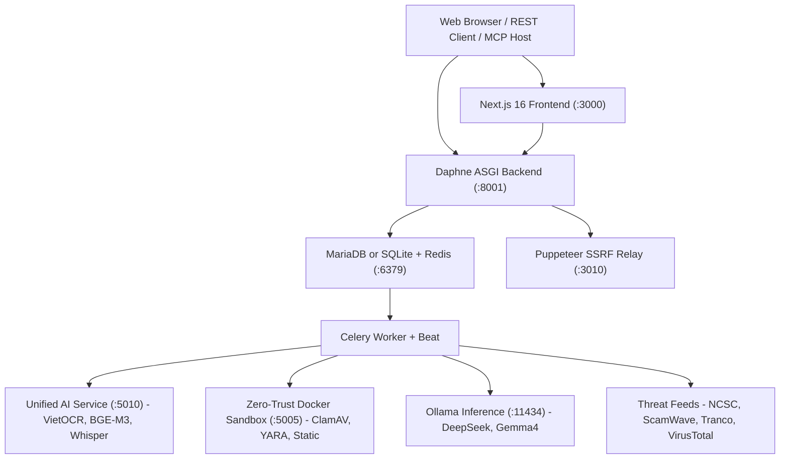

<p align="center">
  
</p>

# ShieldCall VN (Sentinel Core)

Multi-modal anti-fraud and cyber threat analysis platform built for Vietnamese digital channels.

- **Live Deployment:** https://sc.fptoj.com
- **API Documentation:** `/api/docs/` (Swagger UI), `/api/redoc/` (ReDoc), `/api/schema/` (OpenAPI 3.0)
- **License:** GNU Affero General Public License v3.0 or later (`AGPL-3.0-or-later`)

## 1. System Capabilities

ShieldCall VN evaluates suspicious inputs across eight verification vectors, cross-checks national and international threat feeds, applies deterministic evidence guardrails (`TrustGuard`), and synthesizes Vietnamese explanations and remediation steps.

| Vector / Module | Primary Endpoints | Underlying Engines & Data Sources |
| :--- | :--- | :--- |
| **SMS / Chat Message** | `POST /api/v1/scan/message/` | Vietnamese heuristic rules (`scam_rules.py`), entity extraction, NCSC, ScamWave, VirusTotal, web search agent, Ollama LLM |
| **Website / URL** | `POST /api/v1/scan/domain/` | DNS/MX, WHOIS domain age, TLS inspection, Tranco rank, NCSC directory, SSRF-isolated Puppeteer DOM capture |
| **Image / Screenshot / QR** | `POST /api/v1/scan/image/` | VietOCR + CRAFT text detection, Tesseract (`vie+eng`) fallback, `pyzbar` QR decoder, vision LLM fallback |
| **Phone Number** | `POST /api/v1/scan/phone/` | `phonenumbers` E.164 normalization, carrier lookup, moderated community reports, OSINT correlation |
| **Bank Account** | `POST /api/v1/scan/bank/` | VietQR bank directory resolution, moderated fraud report ledger, account pattern verification |
| **Email (`.eml` / Raw)** | `POST /api/v1/scan/email/` | RFC-5322 header parser, SPF/DKIM/DMARC authentication checks, embedded link and attachment inspection |
| **Voice / Audio** | `POST /api/v1/scan/audio/` | `Faster-Whisper` (`large-v3-turbo` GPU / `small` CPU fallback) transcription + coercion/impersonation analysis |
| **Executable / Document** | `POST /api/v1/scan/file/` | Zero-Trust Docker sandbox (`--network none`, `--read-only`, `--cap-drop ALL`), YARA, ClamAV, OLETools, PEFile, PyPDF |
| **AI Assistant & Knowledge** | `POST /api/v1/chat/stream/` | Multilingual `BAAI/bge-m3` (1024-dim) + FAISS RAG over Vietnamese advisories, lessons, quizzes, and scenarios |

### Evidence & Privacy Guardrails

1. **Tiered Evidence Policy (`TrustGuard`):** Every scan returns structured `evidence[]`, `guardrail.tier` (`CONFIRMED_RISK`, `HIGH_RISK`, `SUSPICIOUS`, `INSUFFICIENT`, `LIKELY_SAFE`), `cautions[]`, and tier-aligned `actions[]`. Inputs lacking independent benign verification never receive a `"safe"` verdict.
2. **Source Freshness & Error Isolation:** Directory records older than 90 days (`STALE_SOURCE_MAX_DAYS = 90`) are excluded from benign confirmation. External lookup failures and 404/reCAPTCHA/Cloudflare noise pages are isolated per tool so single-service outages cannot corrupt final guidance.
3. **PII Redaction:** Phone numbers, bank accounts, emails, citizen IDs, card numbers, and tokens are masked (`PIIRedactionFilter` + outbound LLM sanitizer) before logging or external model calls, accompanied by a user-visible privacy receipt.

## 2. Architecture & Runtime Services



| Service Name | Default Port | Directory & Entrypoint | Responsibility |
| :--- | :--- | :--- | :--- |
| `pkv-frontend` | `3000` | `frontend/` (`next start`) | Next.js 16 App Router UI and static pages |
| `pkv-web` | `8001` | `backend/` (`daphne PKV.asgi:application`) | REST API, WebSocket scan progress, SSE chat streaming |
| `pkv-celery` | internal | `backend/` (`celery -A PKV worker`) | Asynchronous multi-tool scan pipeline, sandbox jobs, RAG index rebuilds |
| `pkv-celery-beat` | internal | `backend/` (`celery -A PKV beat`) | Scheduled NCSC/ScamWave/news sync, stale scan cleanup, S3 backups |
| `pkv-ai` | `5010` | `backend/scripts/ai_service.py` | Shared neural daemon hosting VietOCR, `BAAI/bge-m3` embeddings, and `Faster-Whisper` |
| `pkv-puppeteer` | `3010` | `puppeteer_host/dist/index.js` | Headless Chromium renderer with private-IP/DNS-rebinding SSRF blocking |

## 3. Installation & Setup

### 3.1 System Prerequisites (Ubuntu 22.04 / 24.04)

```bash
sudo apt-get update && sudo apt-get install -y \
  python3.11 python3.11-venv python3-pip \
  mariadb-server redis-server \
  clamav clamav-daemon libzbar0 tesseract-ocr tesseract-ocr-vie \
  docker.io docker-compose-v2 \
  chromium-browser chromium-chromedriver \
  nodejs npm ffmpeg git

sudo systemctl enable --now mariadb redis-server docker clamav-daemon
sudo usermod -aG docker "$USER"
sudo npm install -g pm2
```

> **Note:** Node.js 20+ (24.x recommended) is required for `frontend/` and `puppeteer_host/`. NVIDIA CUDA is optional; on CPU-only hosts set `VIETOCR_DEVICE=cpu`, `WHISPER_DEVICE=cpu`, and `VECTOR_DB_USE_GPU=False` in `backend/.env`.

### 3.2 Python Environment & Neural Packages

Run from the repository root (`Sentinel_Team_Project/`):

```bash
python3.11 -m venv .venv
.venv/bin/pip install -U pip
.venv/bin/pip install -r backend/requirements.txt

# Install VietOCR and CRAFT text detector without overriding opencv-python-headless / numpy:
.venv/bin/pip install gdown
.venv/bin/pip install --no-deps vietocr==0.3.13 craft-text-detector
```

### 3.3 Environment & Database Configuration

Copy the configuration templates:

```bash
cp backend/PKV/settings.py.example backend/PKV/settings.py
cp backend/.env.example backend/.env
cp frontend/.env.example frontend/.env.local
```

 Key settings in `backend/.env`:

| Variable | Default Value | Description |
| :--- | :--- | :--- |
| `DB_ENGINE` | `sqlite3` | Use `sqlite3` for zero-setup local runs, or `mysql` for MariaDB/MySQL production |
| `REDIS_URL` | `redis://127.0.0.1:6379/0` | Broker and Channels backing store (`REDIS_CACHE_URL` uses `/1`) |
| `OLLAMA_BASE_URL` | `http://localhost:11434` | Local or cloud-proxied Ollama endpoint (`OLLAMA_API_KEY` optional) |
| `LLM_MODEL` | `deepseek-v4.1-flash:cloud` | Primary reasoning model (`SMALL_MODEL=gemma4:31b-cloud`, `LLM_VISION_MODEL=gemma4:latest`) |
| `AI_SERVICE_URL` | `http://127.0.0.1:5010` | Internal URL of `pkv-ai` (`AI_EMBED_MODEL=BAAI/bge-m3`) |
| `VT_API_KEY` | empty | Optional VirusTotal v3 API key (pipeline degrades cleanly when unset) |

If running with MariaDB (`DB_ENGINE=mysql`), create the database and user before migrating:

```sql
CREATE DATABASE shieldcall_db CHARACTER SET utf8mb4 COLLATE utf8mb4_unicode_ci;
CREATE USER 'shieldcall_user'@'127.0.0.1' IDENTIFIED BY 'your_strong_password';
GRANT ALL PRIVILEGES ON shieldcall_db.* TO 'shieldcall_user'@'127.0.0.1';
FLUSH PRIVILEGES;
```

### 3.4 Database Migration, Knowledge Seed & Vector Index

```bash
cd backend
../.venv/bin/python manage.py migrate
../.venv/bin/python manage.py collectstatic --noinput
../.venv/bin/python manage.py seed_vn_knowledge
../.venv/bin/python manage.py download_tts_voice
../.venv/bin/python -c "import django; django.setup(); from api.utils.vector_db import vector_db; vector_db.rebuild_index()"
cd ..
```

### 3.5 Sandbox Container, Puppeteer Relay & Frontend Build

```bash
# 1. Build Zero-Trust malware analysis image (and optionally start the low-latency daemon on :5005)
docker build -t sentinel-sandbox:latest ./backend/sandbox
docker run -d --name sentinel-sandbox-daemon -p 127.0.0.1:5005:5005 \
  --security-opt no-new-privileges:true --read-only \
  --tmpfs /tmp:rw,size=512m,mode=1777 --tmpfs /var/run/clamav:rw,size=64m,mode=1777 \
  --restart unless-stopped sentinel-sandbox:latest

# 2. Build SSRF-hardened Puppeteer service
cd puppeteer_host && npm install && npm run build && cd ..

# 3. Build Next.js 16 frontend
cd frontend && npm install && npm run build && cd ..
```

### 3.6 Start & Monitor Cluster

```bash
pm2 start ecosystem.config.js
pm2 save
pm2 status
curl -s http://127.0.0.1:5010/health
```

For object storage (`USE_S3_MEDIA` / `USE_S3_STATIC`), Cloudflare Turnstile, Google OAuth2, and SMTP setup, see **[docs/SETUP.md](docs/SETUP.md)**.

## 4. Verification & Testing

```bash
# 1. Django CI regression suite (SQLite + in-memory Channels/Cache, matches GitHub Actions):
(cd backend && DJANGO_SETTINGS_MODULE=PKV.settings_ci ../.venv/bin/python manage.py test --noinput)

# 2. Stage 2 fault-injection integration benchmark (20 scenarios, supports --compare-baseline):
.venv/bin/python backend/scripts/eval/evaluate_e2e_chang2.py --backend-dir backend

# 3. Unmocked Django REST APIClient integration check (eager Celery + live OCR/DB/LLM, 3 cases):
(cd backend && ../.venv/bin/python scripts/eval/verify_real_pipeline_chang2.py)

# 4. Frontend static verification:
(cd frontend && npx tsc --noEmit && npm run lint)
```

## 5. Documentation Index

| Document | Scope |
| :--- | :--- |
| [docs/README.md](docs/README.md) | Documentation directory and conventions |
| [docs/ARCHITECTURE.md](docs/ARCHITECTURE.md) | System topology, multi-tool data flow, sandbox isolation, MCP server |
| [docs/SETUP.md](docs/SETUP.md) | Production `.env` reference, S3 replication, rclone, PM2 operations |
| [docs/API_REFERENCE.md](docs/API_REFERENCE.md) | REST, WebSocket, and SSE endpoint specifications |
| [docs/TESTING.md](docs/TESTING.md) | Unit, sandbox, Puppeteer, OCR, and threshold evaluation guides |
| [docs/TINNHIEM.md](docs/TINNHIEM.md) | NCSC (`tinnhiemmang.vn`) crawler and threat directory sync |
| [docs/OCR_VIETNAMESE.md](docs/OCR_VIETNAMESE.md) | Vietnamese OCR preprocessing, post-processing, and CER benchmarks |
| [docs/BAO_CAO_CAI_TIEN_CHUNG_KET.md](docs/BAO_CAO_CAI_TIEN_CHUNG_KET.md) | Stage 1 Final Round technical improvement report ([PDF](docs/BAO_CAO_CAI_TIEN_CHUNG_KET.pdf)) |
| [docs/REBUTTAL_QA.md](docs/REBUTTAL_QA.md) | Known operational boundaries and technical Q&A |
| [docs/LEGAL_AND_LICENSE.md](docs/LEGAL_AND_LICENSE.md) | `AGPL-3.0-or-later` compliance and third-party dependency license matrix |
| [PROJECT_OVERVIEW.md](PROJECT_OVERVIEW.md) | Vietnamese overview of user-facing screens and workflows |

## 6. License

Copyright (c) 2026 Sentinel Team. Released under the **GNU Affero General Public License v3.0 or later (`AGPL-3.0-or-later`)**; see [LICENSE](LICENSE). Deploying modified versions over a network requires providing the Corresponding Source to users under AGPL Section 13. Third-party libraries and model weights retain their respective upstream licenses as documented in [docs/LEGAL_AND_LICENSE.md](docs/LEGAL_AND_LICENSE.md).
