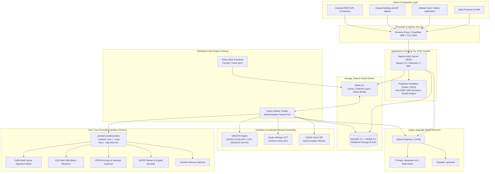
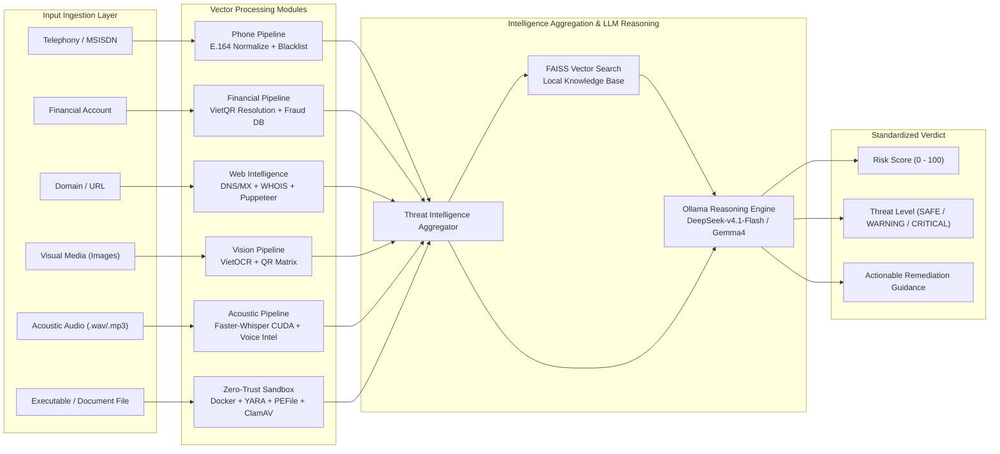
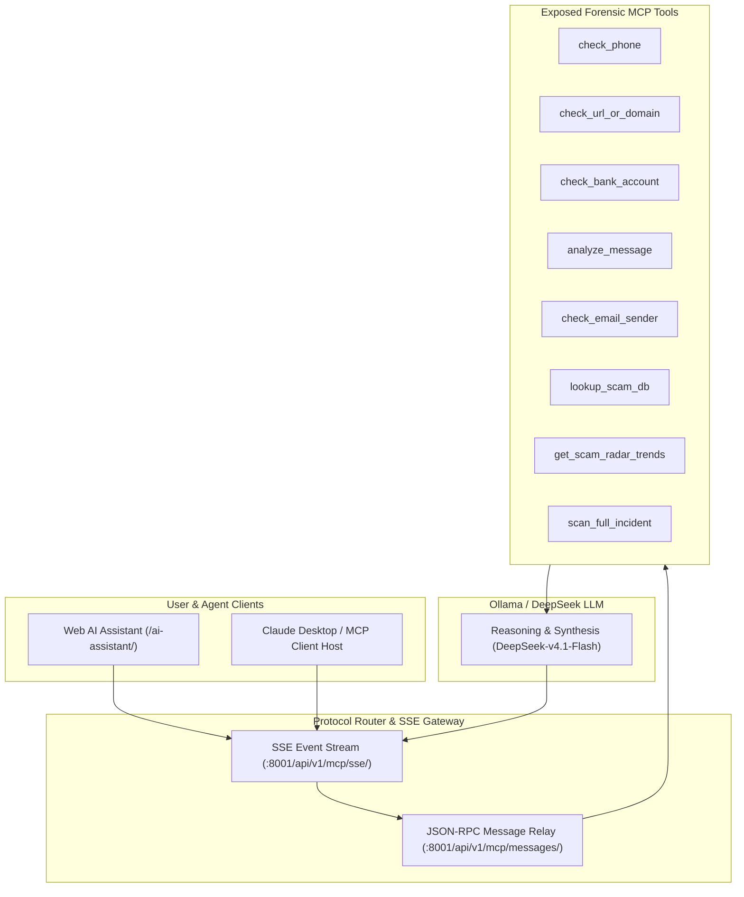

# ShieldCall VN — Architecture

**ShieldCall VN** is an enterprise-grade digital safety and cyber-fraud mitigation platform designed to detect, analyze, and neutralize multifaceted threats across telecommunication, financial, digital communication, and executable file vectors.

The platform employs a hybrid asynchronous architecture combining real-time ASGI WebSocket/SSE streams, background distributed task workers, GPU-accelerated neural computing, and an isolated Zero-Trust Docker Sandbox backed by industry-standard forensic toolsets.

---

## 1. System Architecture Topology

---

## 2. Multi-Vector Threat Analysis Pipeline

The platform evaluates artifacts across six dedicated investigation vectors, aggregates findings into structured telemetry, and executes heuristic and neural risk classification:

### 2.1 Vector Analysis Capabilities

- **Telecommunication & Number Scoring**: Normalizes international and domestic Vietnamese MSISDN formats, cross-referencing threat telemetry, carrier assignments, and community scam reports.
- **Financial Account Verification**: Performs programmatic lookup and beneficiary name resolution via VietQR integration, cross-referencing fraud intelligence databases.
- **Domain & Web Intelligence**: Inspects DNS MX records, domain age (WHOIS), SSL reputation, and ScamAdviser / Trustpilot metrics via SSRF-isolated relays.
- **Email & Messaging Forensics**: Dissects `.eml` and text messages, validating SPF, DKIM, and DMARC DNS alignment to identify spoofed corporate or government origins.
- **Multi-Modal AI Analysis**:
  - **Audio Streams**: Acoustic transcription via `Faster-Whisper` running on NVIDIA CUDA followed by psychological manipulation and urgency indicator extraction.
  - **Visual Media**: Image OCR via `VietOCR` (Vietnamese Transformer served by the shared `pkv-ai` process; `ocr_bridge.py` is the fallback) combined with QR code matrix decoding and phishing banner classification.
- **Malware & APK Sandbox**: Dissects Windows binaries and Android APK packages in isolated Docker environments using YARA rules, PEFile, and ClamAV.
- **Social Engineering & Crypto Forensics**: Tracks Telegram channels, Zalo groups, fake VNeID portals, and suspicious crypto wallet addresses.

### 2.2 Zero-Trust Local Malware Sandbox Engine

Replaces third-party external dependencies with an entirely isolated on-premise containment engine:

- **Containment Model**: Every suspicious file is mounted read-only inside an ephemeral container (`sentinel-sandbox:latest`) with strict enforcement:
  - `--network none`: Complete network isolation. Zero external telemetry or outbound egress.
  - `--read-only`: Read-only root filesystem prevents modification or persistent writes.
  - `--tmpfs /tmp:rw,size=256m,mode=1777`: Bounded writable scratch space (needed for archive unpacking / AV temp files) that never persists.
  - `--cap-drop ALL`: Drops all Linux kernel capabilities.
  - `--security-opt=no-new-privileges:true`: Prevents privilege escalation.
  - `--memory 1g --cpus 2.0 --pids-limit 64`: Throttles resource abuse and prevents fork bombs.

> The long-running daemon (`sentinel-sandbox-daemon`, port 5005) runs with `--read-only`, `--security-opt=no-new-privileges:true`, and tmpfs mounts (`mode=1777`) for `/tmp` + `/var/run/clamav` (the latter lets the ClamAV daemon bind its socket); because it must accept inbound HTTP it keeps the default bridge network (no egress is performed by the analyzer).

- **Multi-Engine Static & Heuristic Dissection**:
  - **YARA Engine**: Scans binary patterns for ransomware extortion notes, process injection calls, and obfuscated droppers.
  - **OLETools (`olevba`)**: Dissects VBA macro streams in `.doc`, `.docx`, `.xls`, `.xlsx`, `.xlsm` files to detect `Auto_Open`, `Shell()`, and `WScript.Shell`.
  - **PEFile Engine**: Computes `imphash`, analyzes section Shannon entropy, and flags critical injection APIs (`VirtualAllocEx`, `WriteProcessMemory`, `CreateRemoteThread`).
  - **PyPDF Dissection**: Flags `/Launch` system execution commands, `/EmbeddedFiles` droppers, and `/JS` JavaScript streams.
  - **ClamAV Engine**: Cross-references against updated open-source antivirus definitions.

### 2.3 Hardened Puppeteer Headless Web Cluster

- **Anti-SSRF Isolation**: Validates all target hostnames and DNS resolutions to block access to private subnets (`10.0.0.0/8`, `172.16.0.0/12`, `192.168.0.0/16`, `127.0.0.0/8`, `169.254.169.254`).
- **Anti-Detection Stealth**: Employs `puppeteer-extra-plugin-stealth` with automated flag masking (`navigator.webdriver` removal, custom humanized User-Agents).
- **Leak Prevention & Resource Optimization**: Utilizes `WeakMap` page tracking, blocks heavy media streams (`audio`, `video`, `fonts`), and automatically recycles browser instances after 50 renders to release accumulated V8 memory.

### 2.4 Model Context Protocol (MCP) Remote Server

Exposes Sentinel threat tools directly to external AI agents, Claude Desktop, and IDE plugins over the standardized Model Context Protocol:

- **Discovery Endpoint**: `GET /api/v1/mcp/`
- **SSE Transport Stream**: `GET /api/v1/mcp/sse/`
- **JSON-RPC Message Relay**: `POST /api/v1/mcp/messages/`
- **Exposed Tools (10)**: `check_phone`, `check_bank_account`, `check_url_or_domain`, `analyze_message`, `check_email_sender`, `get_supported_banks`, `lookup_scam_db`, `get_scam_radar_trends`, `scan_full_incident`, `report_scam`.
- **System Prompts (3)**: `shieldcall_sentry`, `emergency_advisor`, `scam_investigator`.
