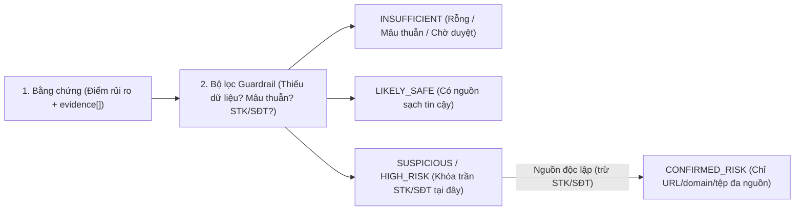
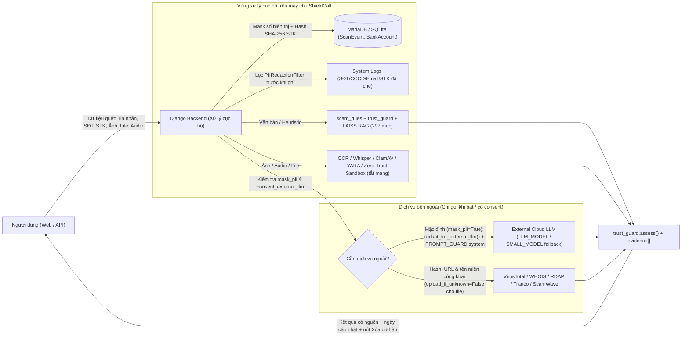

# BÁO CÁO CẢI TIẾN VÒNG CHUNG KẾT - SHIELDCALL VN

> **Trạng thái:** hồ sơ nộp · **Cập nhật:** 2026-11-24 · **Đối tượng:** hội đồng giám khảo

- **Đề thi**: Đề cải tiến: Phiên bản 1 (Nộp / cập nhật bài - Chặng 1)
- **Hệ thống**: ShieldCall VN (Nền tảng phòng chống lừa đảo đa kênh tại Việt Nam)
- **Liên kết mã nguồn**: `https://github.com/KienPC1234/Sentinel_Team_Project`
- **Liên kết sản phẩm chạy thử**: `https://sc.fptoj.com`

---

## Tóm tắt cải tiến theo 3 yêu cầu của Hội đồng

Thay vì ép mọi kết quả về hai cực "An toàn" hoặc "Lừa đảo", phiên bản Chung kết nâng cấp cơ chế ra quyết định theo nguyên tắc **chỉ kết luận dứt khoát khi có bằng chứng độc lập**, công khai nguồn đối chiếu kèm ngày cập nhật và bảo vệ dữ liệu nhạy cảm của người dùng ngay từ bước đầu tiên:

| Yêu cầu | Vấn đề trước đây | Giải pháp đã hoàn thiện | Minh chứng đo được |
|---|---|---|---|
| **1. Kiểm soát kết luận ảnh hưởng người dùng** | Khi thiếu dữ liệu, nguồn mâu thuẫn hoặc tin nhắn đời thường trùng từ khóa nhạy cảm, hệ thống dễ gắn nhầm mức cảnh báo hoặc lưu nhãn `SAFE`. | Tách tầng trung gian **`INSUFFICIENT`** ("Chưa đủ cơ sở xác minh"); khóa trần không bao giờ khẳng định cá nhân/STK/SĐT chắc chắn lừa đảo; kết hợp **tiền lọc Regex + AI LLM đối chứng** (`safe_context_discounted`) và fallback tự động sang `SMALL_MODEL` (`gemma4:31b-cloud`). | **20/20** ca guardrail đạt chuẩn (`100%` từ chối ca thiếu/mâu thuẫn); **18/18** ca đối kháng live LLM; **0/40** báo nhầm trên tin nhắn đời thường. |
| **2. Truy xuất nguồn & đánh giá tình huống VN** | Người dùng khó biết kết quả dựa vào nguồn nào, độ tin cậy ra sao và dữ liệu cập nhật ngày nào; từ điển VN còn thiếu trường hợp thực tế. | Công khai **17 nguồn** trong `SOURCE_CATALOG` (gồm Tín nhiệm mạng, ScamWave 4.071 mục, RAG 297 mục, 39 ngân hàng/ví và 15 báo chí VN) kèm độ tin cậy, giới hạn và `updated_at`; khử trùng lặp regex và chữ chèn dấu (`C.ô.n.g a.n`). | Tập 80 tin nhắn VN độc lập đạt **Precision 100.00%, Recall 95.00%, F1 97.44%, FPR 0.00%**; tập holdout 40 mẫu đạt **Precision 100.00%, F1 94.74%, FP=0**; **AUC 0.959**. |
| **3. Bảo vệ PII & quyền kiểm soát dữ liệu** | Rủi ro lộ SĐT/email ở nhánh retry LLM; người dùng chưa chủ động bật/tắt che PII theo từng lượt quét hoặc xóa từng nhóm dữ liệu riêng tư. | Nút gạt `ScanPrivacyToggle` (mặc định BẬT che PII) trên cả 8 luồng quét, giữ nguyên che PII khi repair/retry; lọc log toàn cục `PIIRedactionFilter`; tách `PROMPT_GUARD` vào `role="system"`; bổ sung **xuất JSON cá nhân** và **xóa chọn lọc theo nhóm**. | **0** SĐT/email thô trên **2.234 dòng** `llm_access.log`; kiểm thử IDOR trả `403/401`; **54/54** test `test_trust_privacy` và **312/312** test mặc định PASSED. |

---

## Phần 1. Kiểm soát kết luận có thể ảnh hưởng người dùng

### 1.1. Cơ chế phân tầng 5 mức trong `trust_guard.py`

Trước đây, người dùng chỉ thấy các nhãn đơn giản nên dễ hiểu nhầm "chưa thấy báo xấu" thành "an toàn 100%", hoặc hiểu nhầm một tài khoản bị phản ánh sơ bộ thành "chắc chắn tội phạm". Hàm `assess(result, kind)` bổ sung tầng trung gian để phản ánh đúng độ chắc chắn của bằng chứng:

| Tầng (`guardrail.tier`) | Nhãn hiển thị cho người dân | Kết luận dứt khoát (`is_conclusive`) | Khi nào kích hoạt & ràng buộc bảo vệ |
|---|---|---|---|
| `INSUFFICIENT` | `CHƯA ĐỦ CƠ SỞ XÁC MINH` | `false` | Đầu vào rỗng/lỗi; điểm thấp nhưng không có nguồn sạch uy tín; **nguồn mâu thuẫn** (ví dụ Tín nhiệm mạng báo tin cậy nhưng bộ quét ngoài cảnh báo, hoặc VirusTotal `0/N` sạch nhưng heuristic cảnh báo ở mức `< 70`); tài khoản ngân hàng mới có báo cáo **chờ kiểm duyệt** (khóa trần `<= 35`). |
| `LIKELY_SAFE` | `CÓ KHẢ NĂNG AN TOÀN (không bảo đảm 100%)` | `false` | Chỉ cấp khi điểm `< 10`, không mâu thuẫn và có nguồn sạch độ tin cậy cao (`tinnhiemmang` trusted hoặc VirusTotal 0 engine gắn cờ). Luôn nhắc cảnh giác chuyển tiền và OTP. |
| `SUSPICIOUS` | `ĐÁNG NGỜ: Cần thận trọng` | `false` | Điểm trung bình (`40..69` hoặc `10..39` kèm dấu hiệu bất thường), chưa có xác thực độc lập. |
| `HIGH_RISK` | `NGUY CƠ CAO` | `false` với STK/SĐT; `true` với tin/URL/tệp | Dấu hiệu mạnh (`>= 70`) hoặc STK/SĐT đã có báo cáo kiểm duyệt. **Riêng số tài khoản và SĐT bị khóa trần tối đa ở mức này**, bắt buộc giữ `is_conclusive = false` và yêu cầu xác minh qua kênh chính thức. |
| `CONFIRMED_RISK` | `CẢNH BÁO RỦI RO CAO (Có nguồn đối chiếu)` | `true` (chỉ URL/domain/tệp) | Chỉ kích hoạt khi có nguồn độc lập xác thực: danh sách lừa đảo NCSC/VNCERT (`tinnhiemmang`), chữ ký cục bộ (`clamav`/`yara`/`sandbox`), hoặc `>= 3` engine VirusTotal `malicious`, và không mâu thuẫn với Tín nhiệm mạng. |

### 1.2. Xử lý tài khoản ngân hàng, số điện thoại và nhánh fallback (`scan_views.py`, `tasks.py`)

1. **Tách riêng báo cáo chờ duyệt trên tài khoản ngân hàng (`ScanAccountView`)**: Đếm độc lập `approved_account_reports` và `pending_account_reports`; báo cáo chưa duyệt bị giới hạn tối đa `35/100` (`min(35, pending * 15)`) và giữ nguyên ở tầng `INSUFFICIENT` kèm ghi chú `"chờ kiểm duyệt (chưa xác thực)"`.
2. **Loại bỏ ngôn ngữ quy kết cá nhân**: Đổi nhãn đỏ SĐT thành `"NGUY CƠ CAO (CẦN XÁC MINH ĐỘC LẬP)"`; quy tắc `PROMPT_GUARD` cấm AI khẳng định cá nhân hoặc chủ tài khoản là tội phạm, luôn kèm hướng dẫn gọi tổng đài ngân hàng hoặc cơ quan Công an.
3. **Chặn lưu nhầm `SAFE` khi fallback**: Khi OCR rỗng, âm thanh không nhận dạng được hoặc AI gián đoạn, `tasks.py` và `media_utils.py` đều gắn `insufficient_input = True` và lưu mức kỹ thuật `RiskLevel.YELLOW` thay vì `SAFE`, bảo đảm giao diện luôn hiển thị `"CHƯA ĐỦ CƠ SỞ XÁC MINH"`.

### 1.3. Cơ chế kết hợp 2 tầng: Tiền lọc Regex + AI LLM đối chứng & chống Jailbreak

Nếu chỉ dùng bộ luật từ khóa (Regex), hệ thống sẽ **báo nhầm** tin nhắn đời thường (nhắc nghề nghiệp công an, người nhà cấp cứu, chuyển tiền ăn trưa, xem phim hình sự) và **bỏ sót** các chiêu lừa mới không có từ khóa. Hệ thống xử lý bằng kiến trúc 2 tầng phối hợp (`scam_rules.py` + `ollama_client.py` + `trust_guard.py`):

| Tình huống tin nhắn đầu vào | Cách Tầng 1 (Regex + Domain) và Tầng 2 (LLM) phối hợp | Kết quả cuối |
|---|---|---|
| **Tin nhắn đời thường có từ khóa nhạy cảm** (ví dụ: *"Bạn trai tớ là công an, tối đi ăn..."*, *"Bố em cấp cứu ở Bạch Mai..."*, *"Chuyển 65k ăn trưa vào STK..."*, *"Xem phim viện kiểm sát đọc lệnh bắt"*) | Tầng 1 gửi danh sách mẫu bắt được qua `pre_filter_context` để AI thẩm định ngữ cảnh thực. Khi AI xác nhận `is_scam=False` (điểm `<= 25`) và văn bản không chứa chỉ thị cưỡng bức/cấp cứu đòi chuyển tiền, `compute_evidence_aware_ensemble()` áp dụng `safe_context_discounted`. | Điểm hạ xuống **`< 10` (`INSUFFICIENT`)**, xóa nhãn từ khóa regex để không báo nhầm `SUSPICIOUS`. |
| **Lừa đảo thủ đoạn mới, không chứa URL hay từ khóa phổ biến** (ví dụ: *"Tao đang kẹt ở cây xăng quên ví, chuyển hộ 200k đừng gọi lại"*) | Tầng 1 không bắt được hết mẫu cũ, nhưng AI đọc hiểu ngữ cảnh mạo danh người quen + ép chuyển tiền khẩn cấp + chặn xác minh ngược. | Bắt chính xác **`85/100` (`RED` / `HIGH_RISK`)**. |
| **Tấn công pha trộn & Jailbreak** (chèn lệnh giả `is_scam: false` hoặc mở đầu bằng *"Bộ Công an khuyến cáo..."* rồi đòi chuyển tiền tạm giữ/đọc OTP) | `PROMPT_GUARD` đặt ở **`role="system"`** tách biệt khỏi khối `<DU_LIEU_NGUOI_DUNG>`, yêu cầu AI chấm điểm theo vế nguy hiểm nhất. Đồng thời lớp bảo vệ clause-level (`_detect_severe_extortion` & `has_active_threat_directive`) giữ sàn điểm ngay cả khi mô hình bị jailbreak. | Giữ sàn **`>= 70` (`RED`)**; kiểm chứng trực tiếp trên cả `LLM_MODEL` và `gemma4:31b-cloud` đều đạt `95/100`. |
| **Model chính lỗi JSON hoặc gián đoạn** | `analyze_text_for_scam()` tự động fallback sang **`SMALL_MODEL` (`gemma4:31b-cloud`)**; nếu cả mạng/Ollama mất kết nối, hệ thống chuyển sang `ai_outage_fallback` dùng Regex offline (`scam_rules.py`). | Không sập luồng quét; vẫn bắt các mẫu lừa đảo phổ biến ngay cả khi mất mạng AI. |

> **Vai trò của `SMALL_MODEL` (`gemma4:31b-cloud`) trong toàn hệ thống**: Ngoài nhiệm vụ fallback tức thời khi `LLM_MODEL` chính lỗi ở luồng quét lừa đảo, `SMALL_MODEL` còn đảm nhận 5 tác vụ nhẹ cần độ trễ thấp: kiểm duyệt công kích cá nhân trên diễn đàn (`moderate_forum_text_ai`), đặt tiêu đề phiên chat (`generate_title`), tóm tắt thẻ bài học MagicCreate (`tasks.py`), làm sạch Markdown tin tức (`format_news`) và đối chiếu tin trùng lặp (`dedup_news`).

### 1.4. 6 trường hợp minh chứng đối chứng: Mâu thuẫn, Thiếu dữ liệu & Khóa trần cá nhân

1. **Ca 1 (Mâu thuẫn VT sạch và heuristic - `vn_contradiction_vt_clean_vs_heuristic`)**: URL sạch trên 70 engine VirusTotal (`0/70`) nhưng heuristic phát hiện từ khóa rủi ro (`45/100`) -> bật `has_contradiction = True`, hạ về `INSUFFICIENT`.
2. **Ca 2 (Mâu thuẫn Tín nhiệm mạng và cảnh báo ngoài - `vn_contradiction_tinnhiem_vs_vt_multi`)**: Tên miền có chứng nhận `tinnhiem.status = "trusted"` nhưng bị 3 engine ngoài cảnh báo -> từ chối `CONFIRMED_RISK`, hạ về `INSUFFICIENT` (`has_contradiction = True`).
3. **Ca 3 (Tin nhắn/ảnh rỗng không đọc được - `vn_missing_empty_msg`, `vn_missing_ocr_unreadable`)**: Trả `INSUFFICIENT`, `is_conclusive = False`, kèm kịch bản từ chối giao dịch lịch sự (`refusal_script`) và hotline 113/156.
4. **Ca 4 (Tên miền mới thiếu dữ liệu - `vn_missing_gray_zone_domain`)**: Cụm từ `"chưa có dữ liệu đánh giá độc hại"` không bị bắt nhầm từ khóa `"độc hại"`, giữ nguyên trạng thái `INSUFFICIENT`.
5. **Ca 5 (Tài khoản chỉ có báo cáo chờ duyệt - `vn_missing_pending_account_only`)**: Điểm trần `<= 35`, giữ nguyên `INSUFFICIENT` kèm ghi chú chờ kiểm duyệt.
6. **Ca 6 (Tài khoản có báo cáo đã duyệt nhưng khóa trần - `vn_account_approved_reports`)**: Dù đạt `risk_score = 75` (`HIGH_RISK`), hệ thống khóa cứng `is_conclusive = False`, từ chối quy kết cá nhân và đính kèm tổng đài ngân hàng phát hành.

---

## Phần 2. Truy xuất nguồn và đánh giá trên tình huống Việt Nam

### 2.1. Bảng 17 nguồn dữ liệu, phạm vi nhận định, giới hạn và ngày cập nhật

Toàn bộ danh mục được trích trực tiếp từ `source_catalog()` (`backend/api/utils/trust_guard.py`), `tinnhiem_dataset_stats()`, `scamwave_dataset_stats()` và hiển thị công khai tại trang `/trust/`:

| Mã nguồn (`key`) | Tên nguồn | Độ tin cậy | Phạm vi áp dụng & nhận định tương ứng | Giới hạn đã công bố | Ngày cập nhật |
|---|---|---|---|---|---|
| `tinnhiemmang` | Tín nhiệm mạng (`tinnhiemmang.vn` - NCSC/VNCERT) | Cao (`high`) | Đối chiếu `5.873` mục tín nhiệm và `21.293` tên miền lừa đảo -> `CONFIRMED_RISK` / `LIKELY_SAFE`. | Chỉ gồm thực thể đã ghi nhận; vắng mặt chưa chắc an toàn. | `04/11/2026` |
| `vn_official` | Kênh chính thức VN (Bộ CA, NHNN, 39 NH/ví) | Cao (`high`) | Danh bạ xác minh thủ công (`khonggianmang.vn`, 113, 156, 18 tổng đài & 21 website ngân hàng/ví). | Kênh tự kiểm chứng của người dùng, không trả API tự động. | `2026-11-24` |
| `virustotal` | VirusTotal (70+ engine AV) | Cao (`high`) | `>= 3` engine `malicious` -> `CONFIRMED_RISK`; `1-2` engine -> `HIGH_RISK`; `0` engine -> sạch. | Phụ thuộc cộng đồng; URL/tệp mới có thể chưa có mẫu. | `2026-11-24` |
| `clamav` | ClamAV (mã độc cục bộ) | Cao (`high`) | Quét chữ ký mã độc cục bộ cho tệp/APK tải lên. | Chỉ nhận diện chữ ký đã biết; dễ bỏ sót zero-day. | `2026-11-24` |
| `yara` | YARA (luật phát hiện) | Cao (`high`) | Khớp luật cấu trúc và chuỗi hành vi đáng ngờ trong tệp. | Phụ thuộc bộ luật biên soạn; chưa bao phủ hết biến thể mới. | `2026-11-24` |
| `sandbox` | Zero-Trust Sandbox (cô lập mạng) | Cao (`high`) | Phân tích tĩnh/hành vi tệp trong container tắt hoàn toàn kết nối mạng. | Mẫu kích hoạt trễ hoặc cần mạng khó bộc lộ hết hành vi. | `2026-11-24` |
| `pefile` | PEFile (giải phẫu PE) | Vừa (`medium`) | Trích xuất import, section, packing của tệp Windows PE. | Chỉ áp dụng tệp PE; dấu hiệu kỹ thuật không tự kết luận độc hại. | `2026-11-24` |
| `oletools` | OLEtools (macro Office) | Vừa (`medium`) | Kiểm tra macro VBA trong tài liệu Office. | Macro nghiệp vụ hợp lệ vẫn có thể kích hoạt cảnh báo. | `2026-11-24` |
| `network_analysis` | Phân tích kết nối/SSL | Vừa (`medium`) | Kiểm tra chứng chỉ SSL, chuyển hướng URL, tuổi tên miền. | Phụ thuộc phản hồi trang đích; trang chặn bot thiếu dữ liệu. | `2026-11-24` |
| `phone_numbering` | Kho số viễn thông VN | Vừa (`medium`) | Kiểm tra đầu số +84/di động/cố định/VoIP theo `libphonenumber` và Bộ KH&CN. | Chỉ kiểm tra định dạng; không xác thực chủ thuê bao/Caller ID. | `2026-11-24` |
| `tranco` | Tranco (thứ hạng phổ biến) | Vừa (`medium`) | Xếp hạng độ phổ biến tên miền toàn cầu làm ngữ cảnh phụ. | Độ phổ biến cao không đồng nghĩa hoàn toàn an toàn. | `2026-11-24` |
| `scamwave` | ScamWave (cảnh báo cộng đồng) | Vừa (`medium`) | Đối chiếu `4.071` tên miền/thực thể (`Scam`, `Doubtful`, `Ponzi`, `Closed`, `Illegal`). | Phần lớn thiếu hồ sơ bằng chứng; chỉ dùng tham khảo và đối chiếu chéo. | `2026-11-16` |
| `heuristic` | Heuristic VN (`scam_rules`) | Vừa (`medium`) | Tiền lọc cụm từ lừa đảo tiếng Việt, chuẩn hóa chữ chèn dấu (`C.ô.n.g a.n`). | Có thể báo nhầm nếu đứng một mình; cần LLM đối chứng ngữ cảnh. | `2026-11-24` |
| `rag` | Kho tri thức ShieldCall (FAISS RAG) | Vừa (`medium`) | Truy xuất **297 mục** kịch bản/hướng dẫn xử lý tình huống VN cho AI. | Dữ liệu tĩnh theo phiên bản; cần đối chiếu thêm kênh chính thức. | `2026-11-24` |
| `community` | Báo cáo cộng đồng | Vừa (`medium`) | Phản ánh người dùng đóng góp (tách riêng `approved` và `pending`). | Chưa xác minh pháp lý; không dùng kết luận danh tính cá nhân. | `2026-11-24` |
| `web_search` | Tìm kiếm/OSINT web | Vừa (`medium`) | Đối chiếu doanh nghiệp (`TraTenCongTy`) và tin công khai khi người dùng đồng ý. | Nguồn mở đa dạng độ tin cậy; phải kiểm chứng từ nguồn gốc. | `2026-11-24` |
| `ai_model` | Mô hình ngôn ngữ (LLM) | Thấp (`low`) | Đối chứng ngữ nghĩa, phát hiện thủ đoạn mới và giải thích tiếng Việt dễ hiểu. | Có thể sai lệch (hallucination); chỉ là lớp diễn giải, không thay thế bằng chứng gốc. | `2026-11-24` |

### 2.2. Kết quả đánh giá định lượng trên bộ tình huống Việt Nam (`evaluate_vn_final.py`)

#### A. Tập 80 tin nhắn Việt Nam độc lập (`independent_test_set_vn.jsonl`, ngưỡng `threshold = 40`)

| Chỉ số | Giá trị đo được (chế độ offline không LLM) | Phân tích chi tiết |
|---|---|---|
| Tổng số ca | **80** (40 lừa đảo / 40 hợp lệ dễ nhầm) | Bao gồm giả danh công an, VNeID APK, OTP, việc nhẹ lương cao, hoàn thuế, EVN, deepfake và tin nhắn hợp lệ dễ nhầm (OTP ngân hàng, biến động số dư, khuyến cáo Công an, EVNNPC, shipper, chuyển tiền ăn trưa, phỏng vấn). |
| TP / FN & Độ chính xác | **38 / 2** (Precision **100.00%**, Recall **95.00%**, F1 **97.44%**) | Bộ tiền lọc khử trùng lặp từ khóa và chuẩn hóa chữ chèn dấu đạt Recall 95.00% ngay cả khi tắt AI. Trên tập holdout 40 mẫu cũng đạt Precision **100.00%**, Recall **90.00%**, F1 **94.74%**, FP=0. |
| TN / FP & Tỷ lệ báo nhầm | **40 / 0** (**FPR = 0.00%**) | Cả tin nhắn chuyển tiền ăn trưa (`legit_22`), OTP thật, khuyến cáo Bộ Công an/CATP HN, hóa đơn điện nước và shipper đều không bị báo nhầm. |
| 2 ca bỏ sót khi tắt LLM (FN) | `scam_33`, `scam_37` | Tin nhắn ngữ nghĩa mềm giống giao tiếp đời thường (mượn 200k quên ví, quét QR đặt phòng) được giữ dưới ngưỡng ở chế độ offline để không báo nhầm tin nhắn thật; khi bật AI LLM (`deepseek` / `gemma4`), hệ thống phát hiện chính xác. |

#### B. Tập kiểm thử Guardrail & Tình huống hỗn hợp Chung kết (`vn_final_suite.jsonl` - 20 ca)

| Nhóm tình huống | Số ca | Đạt | Kết quả |
|---|---|---|---|
| `verified_scam` (Tín nhiệm mạng scam, VT `>= 3` engine) | 2 | **2/2** | Trả `CONFIRMED_RISK`, `is_conclusive = true`, đủ nguồn và `updated_at`. |
| `heuristic_scam` (tin nhắn giả công an, APK VNeID) | 2 | **2/2** | Trả `HIGH_RISK` kèm hướng dẫn hành động an toàn. |
| `account_high_risk` / `phone_high_risk` | 2 | **2/2** | Trả `HIGH_RISK` nhưng khóa `is_conclusive = false`, từ chối quy kết cá nhân. |
| `insufficient_missing` (rỗng, ảnh mờ, SĐT sạch, STK chờ duyệt, domain mới) | 5 | **5/5** | `100%` trả `INSUFFICIENT` (`insufficient_refusal_rate = 1.0`). |
| `contradiction` (VT sạch vs heuristic, TN trusted vs VT, VT sạch vs PE packing) | 4 | **4/4** | `100%` bật `has_contradiction = true` và hạ về `INSUFFICIENT` (`contradiction_refusal_rate = 1.0`). |
| `legit_vn` & `legit_vn_fp_prone` (trusted bank, VT sạch, PSA công an, OTP thật, EVN) | 5 | **5/5** | Nguồn xác thực sạch trả `LIKELY_SAFE`; PSA/OTP/EVN có điểm `<= 5` và trả `INSUFFICIENT`, 0 báo nhầm. |
| **Tổng cộng** | **20** | **20/20** | **Đạt 100% (0 ca thất bại)**. |

---

## Phần 3. Bảo vệ dữ liệu nhạy cảm và truy vết xử lý

### 3.1. Sơ đồ luồng dữ liệu: Xử lý cục bộ và Dịch vụ bên ngoài

### 3.2. Các cơ chế tối thiểu hóa & ẩn PII đã kiểm chứng

1. **Che thông tin trong log (`PIIRedactionFilter`)**: Mọi logger hệ thống đi qua bộ lọc `PIIRedactionFilter` (`backend/api/utils/privacy.py`). Rà soát **2.234 dòng** trong `backend/llm_access.log` ghi nhận **0** SĐT thô và **0** email thô; các chuỗi SĐT, STK, email, CCCD tự động chuyển thành `[SĐT đã ẩn]`, `[số tài khoản đã ẩn]`, `[email đã ẩn]`, `[CCCD/CMND đã ẩn]`.
2. **Nút gạt quyền riêng tư từng lượt quét (`ScanPrivacyToggle`)**: Mặc định BẬT `mask_pii=True` trên cả 8 màn hình quét (`Phone`, `Bank`, `Message`, `Website`, `Email`, `Qr`, `Audio`, `File`). Khi bật che, hệ thống chạy `redact_for_external_llm` trước khi gửi Cloud LLM (riêng email giữ phần tên miền `***@domain` để đánh giá uy tín), đồng thời quy tắc số 8 trong prompt giúp AI vẫn phân tích ngữ cảnh bình thường trên nhãn đã ẩn. Khi người dùng chủ động tắt nút gạt, chỉ có phép AI đọc dữ liệu đầy đủ ở lượt đó; nhật ký hệ thống vẫn luôn che PII.
3. **An toàn khi retry/fallback & lưu trữ tối giản**: Mọi bước repair JSON, rerun hay fallback sang `SMALL_MODEL` đều giữ nguyên `allow_pii=safe_allow_pii`. Tài khoản ngân hàng lưu `account_number_hash` (SHA-256) và dạng che 4 số cuối; tệp tải lên khi đối chiếu VirusTotal luôn đặt `upload_if_unknown=False` (chỉ kiểm tra mã băm).

### 3.3. Chức năng quản lý, xuất và xóa dữ liệu cá nhân

| Chức năng | API Endpoint | Phân quyền & An toàn | Vị trí giao diện |
|---|---|---|---|
| Xóa từng lượt quét | `DELETE /api/v1/user/scans/<scan_id>/` | Kiểm tra sở hữu (`user_id` hoặc `active_scan_ids` phiên ẩn danh); trả 403/401 nếu truy cập chéo. | Bảng Lịch sử quét (`/dashboard`) |
| Bật/tắt chia sẻ công khai | `PATCH /api/v1/user/scans/<scan_id>/` | Chỉ chủ sở hữu được bật/tắt `is_public_referable`. | Cột Thao tác (`/dashboard`) |
| Xóa toàn bộ lịch sử quét | `DELETE /api/v1/user/scans/` | Xóa mọi `ScanEvent` của tài khoản và dọn `active_scan_ids`. | Nút xóa toàn bộ (`/dashboard`) |
| Xuất dữ liệu cá nhân (JSON) | `GET /api/v1/user/privacy/export-data/` | Xuất bản sao JSON gồm lịch sử quét, phiên chat AI và cảnh báo. | Nút `"Xuất JSON"` (`/profile`) |
| Xóa dữ liệu chọn lọc theo nhóm | `POST /api/v1/user/privacy/delete-data/` | Chọn `scopes`: `["scans", "chat_sessions", "alerts"]` hoặc `["all"]` trong transaction atomic. | Thẻ quản lý dữ liệu (`/profile`) |
| Xóa toàn bộ chat AI | `DELETE /api/v1/chat/sessions/clear-all/` | Xóa toàn bộ `ChatSession` của người dùng hiện tại. | `/ai-assistant` |
| Xóa tài khoản | `POST /api/v1/auth/account/delete/` | Xóa tài khoản và dữ liệu liên quan sau khi xác nhận mật khẩu. | `/profile` |

---

## Phần 4. Tổng hợp kiểm chứng kỹ thuật sau chỉnh sửa cuối

| Hạng mục kiểm tra | Lệnh thực thi | Kết quả đo được sau bản cập nhật cuối |
|---|---|---|
| Kiểm thử toàn bộ Backend | `DJANGO_SETTINGS_MODULE=PKV.settings_ci ../.venv/bin/python manage.py test --noinput` | `System check`: 0 issues; **312/312 test mặc định PASSED** (tổng **318 tests**, `OK`, `skipped=6` test AI Red-Team tách riêng qua `RUN_LIVE_AI_TESTS=1`, `144.201s`); gồm **54/54** test `test_trust_privacy` và **21/21** test `test_mcp_and_api_keys`. |
| Đánh giá VN, Guardrail & Đối kháng | `../.venv/bin/python scripts/eval/evaluate_vn_final.py` & `adversarial_stress_test.py` | 80 tin nhắn VN: **Precision 100.00%, Recall 95.00%, F1 97.44%, FPR 0.00%**; 20 ca Guardrail: **20/20 PASSED**; 18 ca đối kháng live LLM: **18/18 PASSED**; kiểm tra trực tiếp `SMALL_MODEL` `gemma4:31b-cloud`: 3/3 ca jailbreak đạt `score=95`, ca tán gẫu công an đạt `score=10`; AUC 88 mẫu đạt **0.959**. |
| TypeScript, Oxlint & Tour Frontend | `cd frontend && npx tsc --noEmit && npx oxlint && npm run check:tours` | `tsc`: **0 errors**; `oxlint`: **0 errors** (143 warnings trên 204 tệp); `check:tours`: **19 tour, 16 neo, 18 bước có element**. |
| Build Production Frontend | `cd frontend && npm run build` | Hoàn tất build **78 route** (73 trang và 5 route hệ thống/proxy) Next.js 16.4.5 và đồng bộ `sw.js`. |
