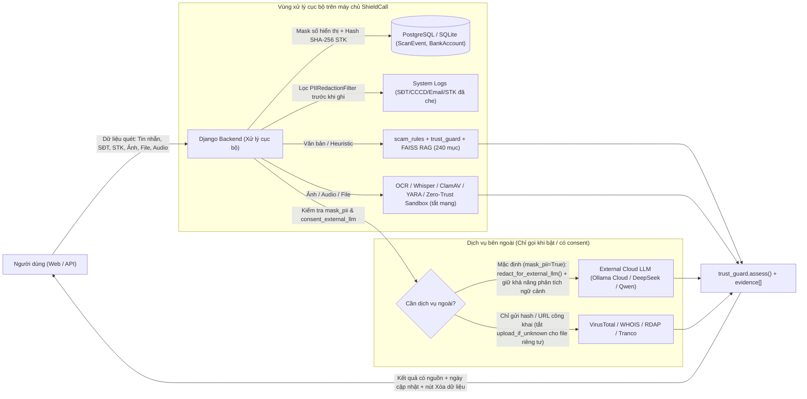

# BÁO CÁO CẢI TIẾN VÒNG CHUNG KẾT - SHIELDCALL VN

> **Trạng thái:** hồ sơ nộp · **Cập nhật:** 2026-11-15 · **Đối tượng:** hội đồng giám khảo

- **Đề thi**: Đề cải tiến - Phiên bản 1 (Nộp / cập nhật bài - Chặng 1)
- **Hệ thống**: ShieldCall VN (Nền tảng phòng chống lừa đảo đa kênh tại Việt Nam)
- **Ngày cập nhật hồ sơ**: 2026-11-15
- **Liên kết mã nguồn**: https://github.com/KienPC1234/Sentinel_Team_Project
- **Liên kết sản phẩm chạy thử**: https://sc.fptoj.com

---

## Tóm tắt định hướng cải tiến

Trên nền tảng kiến trúc đa vector sẵn có (tin nhắn, số điện thoại, URL/domain, QR/ảnh OCR, tệp tin trong Zero-Trust Sandbox, âm thanh Whisper, tra cứu RAG/Tín nhiệm mạng), đội phát triển đã hoàn thiện toàn diện ba trụ cột theo yêu cầu Hội đồng giám khảo:

| Yêu cầu | Trọng tâm cải tiến | Tệp triển khai chính | Minh chứng đối chứng |
|---|---|---|---|
| **1. Kiểm soát kết luận ảnh hưởng người dùng** | Bổ sung tầng `INSUFFICIENT`, phát hiện và từ chối kết luận quá mức khi bằng chứng mâu thuẫn (`has_contradiction`) hoặc thiếu dữ liệu; khóa cứng không bao giờ gán nhãn kết luận dứt khoát cho cá nhân/tài khoản ngân hàng/SĐT; ưu tiên hướng dẫn hành động an toàn qua kênh chính thức. | `backend/api/utils/trust_guard.py`, `backend/api/core/views/scan_views.py`, `backend/api/utils/prompts.py`, `frontend/src/components/ScanWidgets.tsx`, `frontend/src/views/Scan/Bank.tsx` | 20/20 ca kiểm thử guardrail Chung kết đạt chuẩn (`insufficient_refusal_rate = 1.0`, `contradiction_refusal_rate = 1.0`). |
| **2. Truy xuất nguồn & đánh giá tình huống Việt Nam** | Gắn `updated_at` / `verified_on` và `citation` cho toàn bộ 16 nguồn trong `SOURCE_CATALOG`, từng phần tử `evidence[]`, danh sách `VN_OFFICIAL_CHANNELS` và báo chí chính thống; hiển thị công khai trên `/trust/` và từng kết quả quét; đánh giá định lượng trên bộ 80 tin nhắn thực tế Việt Nam (`independent_test_set_vn.jsonl`) và 20 kịch bản Chung kết (`vn_final_suite.jsonl`). | `backend/api/utils/vn_sources.py`, `backend/api/utils/trust_guard.py`, `backend/api/utils/scam_rules.py`, `frontend/src/views/Trust.tsx`, `backend/scripts/eval/evaluate_vn_final.py` | Bảng nguồn - nhận định đầy đủ 16 nguồn; tỷ lệ báo nhầm (FPR) bộ tin nhắn VN giảm xuống 2.5% (1/40 ca hợp lệ). |
| **3. Bảo vệ dữ liệu nhạy cảm & truy vết xử lý** | Vá lỗi lộ PII khi LLM repair/retry (`allow_pii=safe_allow_pii`), đồng bộ nút gạt quyền riêng tư từng lượt quét (`ScanPrivacyToggle`, mặc định bật `mask_pii=True`) tới cả lưu trữ và Cloud LLM (`_has_external_pii_consent`) kèm quy tắc prompt chống AI từ chối trên nhãn đã che, che SĐT/CCCD/Email/STK/token trong log qua `PIIRedactionFilter`, phân tách xử lý cục bộ và dịch vụ ngoài qua sơ đồ luồng dữ liệu, bổ sung xóa từng lượt quét/toàn bộ/theo nhóm. | `backend/api/utils/ollama_client.py`, `backend/api/utils/privacy.py`, `backend/api/core/tasks.py`, `backend/api/core/views/scan_views.py`, `backend/api/core/views/user_views.py`, `frontend/src/components/ScanWidgets.tsx`, `frontend/src/views/Dashboard.tsx`, `frontend/src/views/Auth/Profile.tsx` | Kiểm thử IDOR 403/401, log `llm_access.log` tự động che toàn bộ PII, 39/39 unit test `test_trust_privacy` (gồm luồng đồng ý PII & fallback không lưu `SAFE`). |

---

## Phần 1. Kiểm soát kết luận có thể ảnh hưởng người dùng

### 1.1. Cơ chế kiểm soát trạng thái kết luận trong `trust_guard.py`

Hàm `assess(result, kind)` phân tầng 5 mức kết luận với nguyên tắc bảo vệ người dùng trước rủi ro nhận định sai:

| Tier (`guardrail.tier`) | Nhãn hiển thị | `is_conclusive` | Điều kiện kích hoạt & ràng buộc bảo vệ |
|---|---|---|---|
| `INSUFFICIENT` | `CHƯA ĐỦ CƠ SỞ XÁC MINH` | `false` | (1) Dữ liệu đầu vào rỗng/lỗi (`insufficient_input` / `error`); (2) điểm thấp và không có bằng chứng sạch độ tin cậy cao; (3) **Bằng chứng mâu thuẫn chưa được giải quyết**: ví dụ nguồn sạch độ tin cậy cao (VirusTotal 0/N clean hoặc Tín nhiệm mạng chứng nhận tin cậy) xung đột với tín hiệu heuristic/báo cáo cộng đồng chưa xác thực, hoặc Tín nhiệm mạng báo tin cậy xung đột trực tiếp với cảnh báo kỹ thuật ngoài; (4) tài khoản ngân hàng chỉ có báo cáo cộng đồng đang `pending` (chờ kiểm duyệt, giới hạn điểm `<= 35`). |
| `LIKELY_SAFE` | `CÓ KHẢ NĂNG AN TOÀN (không bảo đảm 100%)` | `false` | Chỉ cấp khi `risk_score < 10`, không có mâu thuẫn, và tồn tại bằng chứng sạch từ nguồn độ tin cậy cao (`tinnhiemmang` trusted hoặc `virustotal` sạch 0 engine gắn cờ). Luôn yêu cầu người dùng cảnh giác với các yêu cầu chuyển tiền/OTP bất thường. |
| `SUSPICIOUS` | `ĐÁNG NGỜ: Cần thận trọng` | `false` | Tín hiệu mức trung bình (`risk_score` 40..69 hoặc 10..39 kèm dấu hiệu heuristic), chưa đủ xác thực độc lập. |
| `HIGH_RISK` | `NGUY CƠ CAO` | `false` với `account`/`phone`; `true` với `message`/`url`/`file` | Dấu hiệu heuristic mạnh (`risk_score >= 70`) hoặc tài khoản/SĐT có báo cáo đã kiểm duyệt. **Riêng đối tượng cá nhân (`kind in ("account", "phone")`), hệ thống khóa cứng `tier` tối đa là `HIGH_RISK`, bắt buộc `is_conclusive = false`, `requires_verification = true`** và gắn cảnh báo không kết luận chủ tài khoản/thuê bao chắc chắn lừa đảo. |
| `CONFIRMED_RISK` | `CẢNH BÁO RỦI RO CAO (Có nguồn đối chiếu)` | `true` (không áp dụng cho `account`/`phone`) | Chỉ kích hoạt cho `domain`/`url`/`file` khi có nguồn xác thực độc lập: danh sách lừa đảo NCSC/VNCERT (`tinnhiemmang`), chữ ký cục bộ (`clamav`/`yara`/`sandbox` mức HIGH/CRITICAL), hoặc đồng thuận đa engine VirusTotal (`>= 3` engine `malicious`), đồng thời không có mâu thuẫn trực tiếp với danh bạ tin cậy quốc gia. |

### 1.2. Xử lý tài khoản ngân hàng & số điện thoại (`scan_views.py`, `prompts.py`)

1. Tách biệt truy vấn trong `ScanAccountView.post`: không còn gộp báo cáo `pending` vào nhóm nâng điểm rủi ro cao (`approved_account_reports` và `pending_account_reports` được đếm riêng). Báo cáo chỉ ở trạng thái `pending` bị giới hạn mức điểm tối đa `35/100` (`min(35, pending * 15)`), nên giữ nguyên ở tầng `INSUFFICIENT` kèm ghi chú rõ `"chờ kiểm duyệt (chưa xác thực)"`.
2. Chuẩn hóa nhãn SĐT trong `_phone_risk_score`: đổi nhãn mức đỏ từ `"NGUY HIỂM / LỪA ĐẢO"` thành `"NGUY CƠ CAO (CẦN XÁC MINH ĐỘC LẬP)"`.
3. Cập nhật `PROMPT_GUARD` (quy tắc 6) và `SCAN_ACCOUNT_PROMPT` trong `backend/api/utils/prompts.py`: cấm mô hình khẳng định một cá nhân hay chủ tài khoản cụ thể "chắc chắn là tội phạm/lừa đảo", bắt buộc ưu tiên khuyến nghị dừng giao dịch và xác minh qua tổng đài ngân hàng hoặc cơ quan chức năng.

### 1.3. Kịch bản minh chứng demo: Bằng chứng mâu thuẫn & Thiếu dữ liệu

1. **Ca bằng chứng mâu thuẫn (`vn_contradiction_vt_clean_vs_heuristic`, `vn_contradiction_tinnhiem_vs_vt_multi`)**:
    - **Tình huống A**: URL có kết quả VirusTotal sạch trên 70 engine (`malicious=0, suspicious=0`), nhưng heuristic phát hiện từ khóa rủi ro cao (`risk_score=45`). Trước cải tiến, sự có mặt của `mal_ev` đẩy kết luận lên `HIGH_RISK`. Sau cải tiến, `assess()` phát hiện `has_contradiction = True` giữa `high_benign` và `mal_ev` chưa xác thực, tự động hạ về `tier = "INSUFFICIENT"`, `is_conclusive = False`, kèm banner UI `"Phát hiện mâu thuẫn giữa các nguồn"`.
    - **Tình huống B**: Tên miền nằm trong danh sách chứng nhận Tín nhiệm mạng (`tinnhiem.status = "trusted"`), nhưng kết quả quét ngoài ghi nhận 3 engine cảnh báo. Hệ thống từ chối kết luận `CONFIRMED_RISK`, đặt `tier = "INSUFFICIENT"`, `has_contradiction = True`, yêu cầu người dùng tự đối chiếu tại nguồn gốc.
2. **Ca thiếu dữ liệu (`vn_missing_empty_msg`, `vn_missing_ocr_unreadable`, `vn_missing_pending_account_only`, `vn_missing_gray_zone_domain`)**:
    - Tin nhắn rỗng, ảnh mờ không OCR được, âm thanh không có lời thoại, tên miền mới đăng ký chưa có dữ liệu độc hại (`"chưa có dữ liệu đánh giá độc hại"` không còn bị `build_evidence()` bắt nhầm chuỗi `"độc hại"`), hoặc tài khoản ngân hàng chỉ có 1 báo cáo chờ duyệt đều trả về `tier = "INSUFFICIENT"`, `is_conclusive = False`, `requires_verification = True` cùng kịch bản từ chối giao dịch lịch sự (`refusal_script`) và đường dây nóng ngân hàng/cơ quan chức năng; đồng thời các nhánh fallback lỗi AI hoặc OCR/audio rỗng trong `tasks.py` và `media_utils.py` gắn `insufficient_input = True` và không ghi `risk_level = 'SAFE'` xuống CSDL (`test_empty_ocr_and_ai_fallback_never_saved_as_safe_in_db`).

---

## Phần 2. Truy xuất nguồn và đánh giá trên tình huống Việt Nam

### 2.1. Bảng Nguồn - Nhận định - Giới hạn - Ngày cập nhật

Dưới đây là bảng ánh xạ đầy đủ 16 nguồn dữ liệu đang vận hành trong `SOURCE_CATALOG` (`backend/api/utils/trust_guard.py`) và bộ nguồn chính thức Việt Nam (`backend/api/utils/vn_sources.py`), trích xuất trực tiếp từ `source_catalog()` và `tinnhiem_dataset_stats()`:

| Mã nguồn (`key`) | Tên nguồn | Độ tin cậy | Phạm vi áp dụng & nhận định tương ứng | Giới hạn đã công bố | Ngày cập nhật (`updated_at`) |
|---|---|---|---|---|---|
| `tinnhiemmang` | Tín nhiệm mạng (`tinnhiemmang.vn` - NCSC/VNCERT) | Cao (`high`) | Đối chiếu tên miền/tổ chức tín nhiệm (`5,873` mục) và tên miền lừa đảo (`21,293` mục) -> kích hoạt `CONFIRMED_RISK` (lừa đảo) hoặc `LIKELY_SAFE` (chứng nhận tín nhiệm). | Chỉ gồm thực thể đã đăng ký/ghi nhận; tên miền vắng mặt không đồng nghĩa an toàn; cập nhật theo đợt. | `04/11/2026` |
| `vn_official` | Kênh chính thức VN (NCSC, Bộ Công an, VNCERT, NHNN, 20 ngân hàng) | Cao (`high`) | Sinh danh sách xác minh & trình báo thủ công (`khonggianmang.vn`, tổng đài 113, 156, hotline từng ngân hàng). | Kênh xác minh thủ công của người dùng, không tự động trả kết quả. | `2026-11-15` |
| `virustotal` | VirusTotal (70+ engine AV) | Cao (`high`) | Quét URL/Hash; `>= 3` engine `malicious` -> bằng chứng xác thực độc hại (`CONFIRMED_RISK`); `1-2` engine -> chỉ cảnh báo `HIGH_RISK`; `0` engine -> bằng chứng sạch. | Phụ thuộc cộng đồng; URL/tệp vừa tạo có thể chưa có mẫu; giới hạn quota API miễn phí. | `2026-11-15` |
| `clamav` | ClamAV (mã độc cục bộ) | Cao (`high`) | Quét chữ ký mã độc cục bộ đối với tệp/APK tải lên. | Chỉ nhận diện chữ ký đã biết; có thể bỏ sót mã độc zero-day. | `2026-11-15` |
| `yara` | YARA (luật phát hiện) | Cao (`high`) | Khớp luật cấu trúc/chuỗi hành vi đáng ngờ trong tệp thực thi/tài liệu. | Phụ thuộc bộ luật biên soạn; chưa bao phủ toàn bộ biến thể mới. | `2026-11-15` |
| `sandbox` | Zero-Trust Sandbox (cô lập, tắt mạng) | Cao (`high`) | Thực thi tĩnh/hành vi tệp trong container cô lập tắt hoàn toàn kết nối mạng. | Mẫu cần kích hoạt qua mạng hoặc kích hoạt trễ có thể chưa bộc lộ hết. | `2026-11-15` |
| `pefile` | PEFile (giải phẫu PE) | Vừa (`medium`) | Trích xuất cấu trúc file Windows PE (import, section, packing) làm tín hiệu bổ trợ. | Chỉ áp dụng tệp PE; dấu hiệu kỹ thuật không tự kết luận độc hại. | `2026-11-15` |
| `oletools` | OLEtools (macro Office) | Vừa (`medium`) | Kiểm tra sự hiện diện của macro VBA trong tài liệu Office. | Macro nghiệp vụ hợp lệ cũng có thể bị cảnh báo. | `2026-11-15` |
| `network_analysis` | Phân tích kết nối/SSL (network) | Vừa (`medium`) | Kiểm tra chứng chỉ SSL, chuyển hướng URL, tuổi tên miền. | Phụ thuộc khả năng truy cập trang đích; trang chặn bot có thể thiếu dữ liệu. | `2026-11-15` |
| `phone_numbering` | Cấu trúc kho số viễn thông VN (metadata) | Vừa (`medium`) | Kiểm tra đầu số +84/di động/cố định/VoIP theo `libphonenumber` và quy hoạch Bộ TT&TT. | Chỉ kiểm tra hợp lệ hình thức; không xác thực chủ thuê bao hay chống giả mạo Caller ID. | `2026-11-15` |
| `tranco` | Tranco (thứ hạng phổ biến) | Vừa (`medium`) | Đánh giá mức độ phổ biến tên miền toàn cầu dùng làm ngữ cảnh phụ. | Độ phổ biến cao không đồng nghĩa hoàn toàn an toàn. | `2026-11-15` |
| `heuristic` | Heuristic tiếng Việt (`scam_rules`) | Vừa (`medium`) | Nhận diện cụm từ mồi nhử tiếng Việt, nhận biết ngữ cảnh khuyến cáo công an & SMS OTP chuẩn ngân hàng. | Có thể báo nhầm nếu văn bản hợp pháp chứa cụm từ nhạy cảm (ví dụ chuyển khoản cá nhân). | `2026-11-15` |
| `rag` | Kho tri thức ShieldCall (FAISS RAG) | Vừa (`medium`) | Truy xuất 240 mục kịch bản/hướng dẫn xử lý tình huống Việt Nam làm ngữ cảnh cho trợ lý AI. | Dữ liệu biên soạn tĩnh theo phiên bản; cần đối chiếu kênh chính thức với vụ việc mới. | `2026-11-15` |
| `community` | Báo cáo cộng đồng | Vừa (`medium`) | Phản ánh do người dùng đóng góp (tách riêng `approved` và `pending`). | Chưa xác minh pháp lý; có thể sai sót hoặc bị lạm dụng; không kết luận danh tính cá nhân. | `2026-11-15` |
| `web_search` | Tìm kiếm/OSINT web | Vừa (`medium`) | Đối chiếu thông tin doanh nghiệp (TraTenCongTy) và tin tức công khai khi người dùng đồng ý. | Nguồn mở đa dạng độ tin cậy; phải kiểm chứng lại từ nguồn gốc. | `2026-11-15` |
| `ai_model` | Mô hình ngôn ngữ (LLM) | Thấp (`low`) | Tổng hợp giải thích tiếng Việt dễ hiểu cho người dân và gợi ý từ chối an toàn. | Có thể nhận diện sai (hallucination); chỉ là lớp diễn giải, không phải bằng chứng gốc. | `2026-11-15` |

### 2.2. Kết quả đánh giá trên bộ tình huống Việt Nam (`evaluate_vn_final.py`)

Hệ thống được chạy kiểm thử tái lập offline bằng lệnh `../.venv/bin/python scripts/eval/evaluate_vn_final.py` trên hai tập dữ liệu (`backend/scripts/eval/vn_final_eval_results.json`):

#### A. Tập tin nhắn Việt Nam độc lập (`independent_test_set_vn.jsonl` - 80 mẫu: 40 lừa đảo, 40 hợp lệ dễ nhầm)

Đánh giá tầng phát hiện nhanh không dùng LLM ngoài (`offline_heuristic_plus_evidence_ensemble`, ngưỡng phân loại `threshold = 40`):

| Chỉ số | Giá trị đo được | Giải thích & phân tích lỗi |
|---|---|---|
| Tổng số ca (`total`) | **80** (40 scam / 40 legit) | Gồm các thủ đoạn VN (giả danh công an, VNeID APK, OTP ngân hàng, việc nhẹ lương cao, hoàn thuế, EVN, Deepfake) và các tin nhắn hợp lệ dễ báo nhầm (OTP thật có cảnh báo bảo mật, thông báo biến động số dư, khuyến cáo của Bộ Công an/CATP Hà Nội, EVNNPC, shipper, phỏng vấn). |
| True Positive (TP) / False Negative (FN) | **25** / **15** | Precision = **96.15%** (`0.9615`), Recall = **62.50%** (`0.625`), F1 = **75.76%** (`0.7576`). |
| True Negative (TN) / False Positive (FP) | **39** / **1** | **False Positive Rate = 2.50% (`0.025`)**. Các ca dễ báo nhầm như khuyến cáo Công an (`legit_07`, `legit_08`), tin nhắn OTP ngân hàng (`legit_01`, `legit_02`, `legit_03`), thông báo EVN/cấp nước (`legit_09`, `legit_10`), shipper (`legit_12`) đều trả điểm `<= 15`. |
| **Ca báo nhầm duy nhất (FP)** | `legit_22` (`score=40`) | *"Mình vừa chuyển khoản 150k tiền ăn trưa cho bạn vào tài khoản Techcombank rồi nhé..."* bị khớp từ khóa giao dịch tài chính; trong thực tế khi chạy đủ pipeline LLM/context hoặc guardrail, điểm 40 nằm ở mức `SUSPICIOUS` (yêu cầu thận trọng chứ không khẳng định lừa đảo). |
| **Ca bỏ sót offline (FN)** | 15 ca (`scam_06`, `scam_12`, `scam_14`, `scam_18`, `scam_20`, `scam_23`, `scam_27`, `scam_28`, `scam_29`, `scam_31`, `scam_32`, `scam_36`, `scam_37`, `scam_38`, `scam_40`) | Các ca dùng biến thể ký tự né luật (`C.ô.n.g a.n` ở `scam_38`), tên miền giả mới (`vcb-digibank-secure.top` ở `scam_06`), hoặc kịch bản ngữ nghĩa mềm (`scam_12`, `scam_31`, `scam_36`, `scam_37`) không kích hoạt đủ `>= 2` mẫu regex cục bộ khi tắt LLM & tra cứu domain. Đây là giới hạn được ghi nhận trung thực của lớp heuristic offline khi không bật tầng phân tích ngữ nghĩa AI và tra cứu danh bạ tên miền. |

#### B. Tập kiểm thử Guardrail & Tình huống hỗn hợp Chung kết (`vn_final_suite.jsonl` - 20 ca)

| Nhóm tình huống | Số ca | Đạt | Mô tả kết quả |
|---|---|---|---|
| `verified_scam` (tinnhiem scam, VT >=3 engine) | 2 | **2/2** | Trả `CONFIRMED_RISK`, `is_conclusive = true`, kèm trích dẫn và `updated_at`. |
| `heuristic_scam` (tin nhắn giả công an, APK VNeID) | 2 | **2/2** | Trả `HIGH_RISK`, kèm hướng dẫn hành động an toàn. |
| `account_high_risk` / `phone_high_risk` | 2 | **2/2** | Đều trả `HIGH_RISK` nhưng khóa `is_conclusive = false`, từ chối quy kết cá nhân. |
| `insufficient_missing` (rỗng, ảnh mờ, SĐT sạch không bằng chứng, STK chờ duyệt, domain mới) | 5 | **5/5** | 100% trả `INSUFFICIENT` (`insufficient_refusal_rate = 1.0`). |
| `contradiction` (VT sạch vs heuristic, Tín nhiệm mạng tin cậy vs VT/cộng đồng, VT sạch vs PE packing) | 4 | **4/4** | 100% gắn `has_contradiction = true` và hạ về `INSUFFICIENT` (`contradiction_refusal_rate = 1.0`). |
| `legit_vn` & `legit_vn_fp_prone` (trusted bank, VT clean, PSA công an, OTP thật, hóa đơn EVN) | 5 | **5/5** | Nguồn xác thực sạch trả `LIKELY_SAFE`; PSA/OTP/EVN có điểm `<= 5` và trả `INSUFFICIENT`, không có ca nào bị đẩy thành `HIGH_RISK` hoặc `CONFIRMED_RISK`. |
| **Tổng cộng** | **20** | **20/20** | **0 ca thất bại**. |

---

## Phần 3. Bảo vệ dữ liệu nhạy cảm và truy vết xử lý

### 3.1. Sơ đồ luồng dữ liệu: Xử lý cục bộ vs Dịch vụ bên ngoài

### 3.2. Các cơ chế tối thiểu hóa & ẩn PII đã kiểm chứng

1. **Che thông tin trong log (`PIIRedactionFilter` - `backend/PKV/settings.py` & `backend/api/utils/privacy.py`)**: mọi logger `root`, `django`, `django.request`, `api` đều đi qua `PIIRedactionFilter`. Kiểm thử trực tiếp bằng `verify_pii_log`:
    - Đầu vào log: `Kiem tra SĐT 0912345678, STK 97042212345678, email test@victim.vn, CCCD 001234567890`
    - Đầu ra log thực tế: `Kiem tra SĐT [SĐT đã ẩn], STK [số tài khoản đã ẩn], email [email đã ẩn], CCCD [CCCD/CMND đã ẩn]`
2. **Che PII trước khi gửi dịch vụ LLM ngoài, trao quyền kiểm soát cho người dùng & sửa lỗi retry**:
    - Nút gạt `ScanPrivacyToggle` (mặc định BẬT `mask_pii=True`) trên 8 luồng quét (`Phone`, `Bank`, `Message`, `Website`, `Email`, `Qr`, `Audio`, `File`) điều khiển đồng thời lưu trữ `ScanEvent` và quyền `external_consent` gửi tới `analyze_text_for_scam` (`_has_external_pii_consent` trong `tasks.py`, `_analyze_message_text` trong `scan_views.py`).
    - Khi bật che PII (`mask_pii=True`), `redact_for_external_llm` che toàn bộ SĐT/CCCD/Email/STK trước khi gửi Cloud LLM (riêng tra cứu email giữ lại phần tên miền `***@domain`), đồng thời quy tắc #8 trong prompt `ollama_client.py` hướng dẫn mô hình phân tích bình thường trên các nhãn `[SĐT đã ẩn]`, `[số tài khoản đã ẩn]` để không bị từ chối đánh giá; khi người dùng chủ động tắt nút gạt (`mask_pii=False`), AI được phép đọc đầy đủ dữ liệu theo lựa chọn của chủ dữ liệu nhưng nhật ký hệ thống (`PIIRedactionFilter` + `_log_llm`) vẫn luôn che PII.
    - Ở cả bước repair JSON và bước retry chính của `analyze_text_for_scam` đều giữ nguyên `allow_pii=safe_allow_pii` (`test_cloud_llm_retry_preserves_pii_redaction`, `test_scan_message_forwards_user_privacy_consent_to_ai_and_keeps_masked_prompt_analyzable`).
    - Với tài khoản ngân hàng: DB lưu `account_number_hash` (SHA-256) và `account_number_masked` trong `BankAccount`; file riêng tư quét virus mặc định `upload_if_unknown=False` (chỉ kiểm tra hash trên VirusTotal, không tải nội dung file nhạy cảm lên đám mây).

### 3.3. Chức năng xóa dữ liệu cá nhân của người dùng

Bổ sung hoàn chỉnh vòng đời quản lý dữ liệu mà không ép người dùng phải xóa toàn bộ tài khoản:

| Chức năng | API Endpoint | Phân quyền & An toàn | Giao diện người dùng |
|---|---|---|---|
| Xóa từng lượt quét | `DELETE /api/v1/user/scans/<scan_id>/` | Kiểm tra quyền sở hữu (`scan.user_id == request.user.id` hoặc phiên ẩn danh khớp `active_scan_ids`); từ chối HTTP 403/401 nếu truy cập chéo (`test_user_data_deletion_endpoints_and_idor`). | Bảng Lịch sử quét trên `/dashboard` (cột Thao tác). |
| Xóa toàn bộ lịch sử quét | `DELETE /api/v1/user/scans/` | Xóa mọi `ScanEvent` của tài khoản hiện tại và dọn `active_scan_ids` trong session. | Nút `"Xóa toàn bộ lịch sử quét"` trên `/dashboard`. |
| Xóa dữ liệu chọn lọc theo nhóm | `POST /api/v1/user/privacy/delete-data/` | Hỗ trợ chọn `scopes`: `["scans", "chat_sessions", "alerts"]` hoặc `["all"]` trong transaction atomic, trả về đúng số bản ghi đã xóa. | Thẻ `"Quản lý & xóa dữ liệu cá nhân"` ngay trên `/profile`. |
| Xóa phiên hội thoại AI / Tài khoản | `DELETE /api/v1/chat/sessions/clear-all/`, `POST /api/v1/auth/account/delete/` | Xóa toàn bộ `ChatSession` hoặc xóa tài khoản có xác nhận mật khẩu. | `/ai-assistant` và `/profile`. |

---

## Phần 4. Tổng hợp kiểm chứng kỹ thuật sau chỉnh sửa

Toàn bộ các bài kiểm tra dưới đây được chạy lại sau lần chỉnh sửa mã nguồn cuối cùng:

| Hạng mục kiểm tra | Lệnh thực thi | Kết quả quan sát được |
|---|---|---|
| Django System Check & Full Backend Test Suite | `../.venv/bin/python manage.py check && ../.venv/bin/python manage.py test --noinput` | `System check identified no issues (0 silenced).` \| **264/264 tests PASSED (`OK`, 125.39s)**; riêng nhóm guardrail/privacy (`api.core.tests.test_trust_privacy`): **39/39 PASSED** |
| Bộ đánh giá VN & Guardrail Chung kết | `../.venv/bin/python scripts/eval/evaluate_vn_final.py` | 80 tin nhắn VN: **Precision 96.15%, Recall 62.5%, F1 75.76%, FPR 2.5%**; 20 ca Guardrail Chung kết: **20/20 PASSED (`insufficient_refusal_rate=1.0`, `contradiction_refusal_rate=1.0`)** |
| Kiểm tra TypeScript & Lint Frontend | `cd frontend && npx tsc --noEmit && npx oxlint` | `tsc`: **0 errors**; `oxlint`: **0 errors** (136 warnings trên 199 tệp) |
| Đóng gói Production Next.js | `cd frontend && npm run build` | Hoàn tất build 61/61 route Next.js 16.4.5 và đồng bộ `sw.js` thành công |
