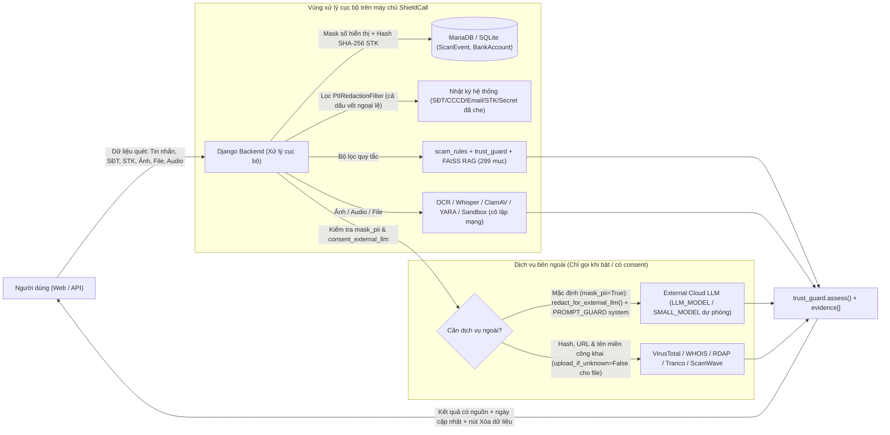

# BÁO CÁO CẢI TIẾN KỸ THUẬT VÒNG CHUNG KẾT - SHIELDCALL VN

> **Trạng thái:** hồ sơ nộp · **Cập nhật:** 2026-11-26 · **Đối tượng:** hội đồng giám khảo

- **Đề thi**: Đề cải tiến: Phiên bản 1 (Nộp / cập nhật bài - Chặng 1)
- **Hệ thống**: ShieldCall VN (Nền tảng phòng chống lừa đảo đa kênh tại Việt Nam)
- **Liên kết mã nguồn**: `https://github.com/KienPC1234/Sentinel_Team_Project`
- **Liên kết sản phẩm chạy thử**: `https://sc.fptoj.com`

---

## Tóm tắt

Báo cáo trình bày những cải tiến của ShieldCall VN theo ba yêu cầu của Hội đồng Giám khảo, tập trung vào kiểm soát kết luận, minh bạch nguồn thông tin và bảo vệ dữ liệu cá nhân.

**Thứ nhất, về độ tin cậy của kết luận**, hệ thống bổ sung trạng thái "Chưa đủ cơ sở xác minh" (`INSUFFICIENT`) để xử lý các trường hợp thiếu dữ liệu hoặc có bằng chứng mâu thuẫn. Đối với số điện thoại và tài khoản ngân hàng, hệ thống giới hạn mức độ kết luận, tránh quy kết cá nhân khi chưa có bằng chứng xác thực và ưu tiên hướng dẫn người dùng xác minh qua các kênh chính thức.

**Thứ hai, về truy xuất nguồn và đánh giá**, ShieldCall chuẩn hóa danh mục 17 nguồn tham chiếu và công cụ phân tích, phân biệt thời điểm cập nhật dữ liệu bên ngoài với thời điểm hệ thống kiểm tra, đối soát nguồn. Trong phép đánh giá ngoại tuyến trên 80 tình huống tin nhắn Việt Nam do nhóm xây dựng, hệ thống phát hiện đúng 38/40 trường hợp lừa đảo và không báo nhầm 40/40 trường hợp hợp lệ.

**Thứ ba, về bảo vệ dữ liệu**, hệ thống tăng cường che thông tin cá nhân trong dữ liệu nhật ký (kể cả dấu vết ngoại lệ khi phát sinh lỗi), bổ sung cảnh báo khi người dùng cho phép gửi dữ liệu nguyên văn tới dịch vụ AI bên ngoài và hoàn thiện chức năng xuất, xóa dữ liệu theo từng nhóm.

Các cải tiến được kiểm chứng thông qua 20 kịch bản kiểm soát kết luận, 18 tình huống kiểm thử đối kháng (12 tình huống gọi mô hình ngôn ngữ thực và 6 tình huống mô phỏng sự cố hoặc phản hồi bị đánh lừa) cùng bộ kiểm thử tự động của hệ thống. Kết quả phản ánh phạm vi đánh giá nội bộ đã thực hiện, đồng thời tạo cơ sở cho việc mở rộng kiểm chứng trong điều kiện sử dụng thực tế.

| Yêu cầu | Vấn đề cần khắc phục | Giải pháp đã triển khai | Kết quả kiểm thử |
|---|---|---|---|
| **1. Kiểm soát kết luận ảnh hưởng người dùng** | Dễ gắn nhãn quá mức khi thiếu dữ liệu, nguồn mâu thuẫn hoặc hội thoại đời thường chứa từ khóa nhạy cảm. | Bổ sung trạng thái chưa đủ căn cứ (`INSUFFICIENT`); giới hạn mức độ kết luận với số điện thoại/tài khoản ngân hàng; kết hợp bộ lọc quy tắc với mô hình ngôn ngữ đánh giá ngữ cảnh và mô hình dự phòng (`gemma4:31b-cloud`); không ghi nhận kết quả an toàn khi dùng cơ chế dự phòng. | **20/20** kịch bản kiểm soát kết luận đạt yêu cầu; **18/18** ca đối kháng (12 ca LLM thực và 6 ca mô phỏng); **0/40** ca báo nhầm trên tin nhắn hợp lệ. |
| **2. Truy xuất nguồn & đánh giá tình huống VN** | Chưa phân biệt thời điểm cập nhật dữ liệu ngoài với ngày rà soát nguồn; thiếu minh họa truy xuất nguồn theo từng nhận định. | Công khai **17 nguồn** kèm `updated_at`, `catalog_verified_at` và `freshness_scope` tại `/trust/` và `evidence[]`; chuẩn hóa từ viết chèn dấu (`C.ô.n.g a.n`). | Đánh giá ngoại tuyến (`ai_result=None`) 80 tin nhắn kịch bản VN: **Precision 100.00%, Recall 95.00%, F1 97.44%, FPR 0.00%**; holdout nội bộ 40 mẫu **F1 94.74%, FP=0**; AUC **0.959**. |
| **3. Bảo vệ dữ liệu nhạy cảm & truy vết** | Nguy cơ lộ dữ liệu cá nhân khi thử lại lời gọi AI hoặc phát sinh lỗi ngoại lệ; mô tả tắt che dữ liệu chưa nêu rõ việc gửi AI ngoài; thiếu bản ghi xóa trước-sau. | Bộ lọc nhật ký (`PIIRedactionFilter`) che cả nội dung thông điệp lẫn dấu vết ngoại lệ; nút gạt riêng tư (`ScanPrivacyToggle`) cảnh báo rõ rủi ro gửi AI ngoài; tách chỉ thị hệ thống khỏi dữ liệu người dùng; hoàn thiện API xuất JSON và xóa theo nhóm. | Không phát hiện SĐT, email, số tài khoản, CCCD hoặc khóa bí mật chưa che trong **2.266 dòng** `llm_access.log`; kết quả xóa đưa số bản ghi trong các mảng JSON từ `1` xuống `0`; kiểm tra truy cập chéo trả `403/401`; **55/55** test `test_trust_privacy` và **313/313** test mặc định PASSED. |

---

## Phần 1. Kiểm soát kết luận có thể ảnh hưởng người dùng

### 1.1. Cơ chế phân tầng 5 mức trong `trust_guard.py`

Hàm kiểm soát mức độ kết luận (`assess(result, kind)`) bổ sung tầng trung gian `INSUFFICIENT` nhằm phản ánh đúng độ chắc chắn của bằng chứng, giới hạn mức độ kết luận đối với số điện thoại và tài khoản ngân hàng, tránh quy kết cá nhân khi chưa có bằng chứng xác thực từ cơ quan chức năng:

| Tầng (`guardrail.tier`) | Nhãn hiển thị cho người dân | Kết luận dứt khoát (`is_conclusive`) | Điều kiện kích hoạt & ràng buộc bảo vệ |
|---|---|---|---|
| `INSUFFICIENT` | `CHƯA ĐỦ CƠ SỞ XÁC MINH` | `false` | Đầu vào rỗng hoặc lỗi; điểm thấp nhưng thiếu nguồn sạch tin cậy cao; **bằng chứng mâu thuẫn** (Tín nhiệm mạng báo `trusted` nhưng bộ quét ngoài cảnh báo, hoặc VirusTotal không phát hiện vi phạm nhưng bộ lọc quy tắc cảnh báo ở mức `< 70`); tài khoản chỉ có báo cáo chờ duyệt (`pending`, trần điểm `<= 35`). |
| `LIKELY_SAFE` | `CÓ KHẢ NĂNG AN TOÀN (không bảo đảm 100%)` | `false` | Chỉ cấp khi `risk_score < 10`, không mâu thuẫn và có nguồn đối chiếu độ tin cậy cao không ghi nhận vi phạm (`tinnhiemmang` tín nhiệm hoặc VirusTotal 0 engine gắn cờ). Luôn nhắc cảnh giác chuyển tiền và OTP. |
| `SUSPICIOUS` | `ĐÁNG NGỜ: Cần thận trọng` | `false` | Tín hiệu mức trung bình (`risk_score` 40..69 hoặc 10..39 kèm dấu hiệu bất thường), chưa đủ cơ sở xác thực độc lập. |
| `HIGH_RISK` | `NGUY CƠ CAO` | `false` với STK/SĐT; `true` với tin/URL/tệp | Dấu hiệu mạnh (`>= 70`), nhiều nguồn cảnh báo hoặc có báo cáo cộng đồng đã kiểm duyệt. **Đối với số tài khoản và số điện thoại, hệ thống khóa trần tối đa tại mức này**, giữ `is_conclusive = false` và yêu cầu xác minh qua kênh chính thức. |
| `CONFIRMED_RISK` | `CẢNH BÁO RỦI RO CAO (Có nguồn đối chiếu)` | `true` (chỉ URL/domain/tệp) | Chỉ kích hoạt cho tên miền, đường dẫn hoặc tệp khi có nguồn độc lập xác nhận: NCSC/VNCERT (`tinnhiemmang`), chữ ký cục bộ (`clamav`/`yara`/`sandbox`), hoặc `>= 3` engine VirusTotal `malicious`, và không mâu thuẫn với Tín nhiệm mạng. |

### 1.2. Xử lý tài khoản ngân hàng, số điện thoại và cơ chế dự phòng (`scan_views.py`, `tasks.py`)

1. **Tách riêng báo cáo chờ duyệt trên tài khoản ngân hàng (`ScanAccountView`)**: Đếm tách bạch `approved_account_reports` và `pending_account_reports`; các phản ánh chưa kiểm duyệt bị giới hạn tối đa `35/100` (`min(35, pending * 15)`) và giữ ở trạng thái chưa đủ căn cứ (`INSUFFICIENT`).
2. **Chuẩn hóa nhãn hiển thị và chỉ thị cho mô hình ngôn ngữ**: Đổi nhãn mức đỏ số điện thoại thành `"NGUY CƠ CAO (CẦN XÁC MINH ĐỘC LẬP)"`; bộ chỉ thị kiểm soát (`PROMPT_GUARD`) yêu cầu mô hình ngôn ngữ không khẳng định cá nhân chắc chắn lừa đảo, luôn ưu tiên hướng dẫn dừng giao dịch và liên hệ tổng đài ngân hàng hoặc cơ quan Công an.
3. **Không ghi nhận kết quả an toàn khi sử dụng cơ chế dự phòng**: Khi trích xuất văn bản ảnh rỗng, âm thanh không nhận dạng được hoặc mô hình ngôn ngữ gián đoạn, `tasks.py` và `media_utils.py` đều gắn `insufficient_input = True` và lưu trạng thái kỹ thuật cần xác minh (`RiskLevel.YELLOW`) thay vì nhãn an toàn (`SAFE`), qua đó đưa các trường hợp này về trạng thái chưa đủ căn cứ (`INSUFFICIENT`).

### 1.3. Kiến trúc phối hợp hai tầng: Bộ lọc quy tắc và Mô hình ngôn ngữ đối chứng

Nếu chỉ dựa vào bộ lọc quy tắc theo từ khóa, hệ thống dễ báo nhầm các hội thoại đời thường chứa từ nhạy cảm và bỏ sót các thủ đoạn mới. Bảng dưới mô tả cơ chế phối hợp giữa bộ lọc quy tắc (`scam_rules.py`), tầng gọi mô hình ngôn ngữ (`ollama_client.py`) và bộ lọc rào chắn (`trust_guard.py`):

| Tình huống đầu vào | Cơ chế phối hợp bộ lọc quy tắc và mô hình ngôn ngữ | Kết quả đầu ra |
|---|---|---|
| **Hội thoại đời thường nhắc từ nhạy cảm** (ví dụ: *"Bạn trai tớ là công an..."*, *"Bố em cấp cứu ở Bạch Mai..."*, *"Chuyển 65k ăn trưa..."*, *"Xem phim viện kiểm sát đọc lệnh bắt"*) | Kết quả từ bộ lọc quy tắc được chuyển cho mô hình ngôn ngữ để đánh giá thêm ngữ cảnh (`pre_filter_context`). Khi mô hình xác nhận `is_scam=False` (điểm `<= 25`) và văn bản không chứa chỉ thị cưỡng ép đòi tiền/OTP, hệ thống áp dụng cơ chế giảm trừ ngữ cảnh an toàn (`safe_context_discounted`). | Điểm hạ xuống **`< 10` (`INSUFFICIENT`)**, loại bỏ nhãn cảnh báo đơn lẻ từ quy tắc từ khóa để tránh báo nhầm. |
| **Lừa đảo thủ đoạn mới, không chứa liên kết hay từ khóa cũ** (ví dụ: *"Tao đang kẹt ở cây xăng quên ví, chuyển hộ 200k đừng gọi lại"*) | Bộ lọc quy tắc chưa bắt hết mẫu mới, nhưng mô hình ngôn ngữ phân tích được ngữ cảnh mạo danh người quen kết hợp thúc ép chuyển tiền và ngăn xác minh ngược. | Phát hiện dấu hiệu rủi ro ở mức **`85/100` (`RED` / `HIGH_RISK`)**. |
| **Tấn công pha trộn & đánh lừa chỉ thị** (chèn lệnh giả `is_scam: false` hoặc mở đầu bằng *"Bộ Công an khuyến cáo..."* rồi đòi chuyển tiền/OTP) | Chỉ thị hệ thống (`PROMPT_GUARD`) đặt ở `role="system"` tách biệt khỏi `<DU_LIEU_NGUOI_DUNG>`, yêu cầu chấm theo vế nguy hiểm nhất; lớp phát hiện hành vi cưỡng bức cấp mệnh đề (`_detect_severe_extortion`) giữ mức cảnh báo cao ngay cả khi mô hình bị đánh lừa. | Duy trì điểm cảnh báo tối thiểu **70/100 (`RED`)** khi phát hiện dấu hiệu cưỡng ép nghiêm trọng; thử nghiệm trên `LLM_MODEL` và `gemma4:31b-cloud` đạt `95/100`. |
| **Mô hình chính gặp lỗi hoặc gián đoạn kết nối** | Hệ thống tự chuyển sang mô hình dự phòng (`SMALL_MODEL` `gemma4:31b-cloud`); nếu toàn bộ kết nối AI gián đoạn, chuyển về cơ chế dự phòng ngoại tuyến (`ai_outage_fallback`) dùng bộ lọc quy tắc. | Duy trì hoạt động phân tích cơ bản bằng bộ lọc quy tắc khi dịch vụ AI gián đoạn. Mô hình nhẹ cũng đảm nhận kiểm duyệt diễn đàn, đặt tiêu đề hội thoại và tóm tắt bài học. |

### 1.4. Kiểm chứng cơ chế Guardrail trên ba tình huống thử nghiệm

Bảng dưới tổng hợp kết quả kiểm thử chức năng `apply_guardrail()` trên ba tình huống thử nghiệm cốt lõi (lưu đầy đủ trong repository tại `docs/minh_chung/01_demo_mau_thuan_va_thieu_du_lieu.json`), kèm trích đoạn JSON đầu ra thể hiện `tier`, `is_conclusive`, `evidence[]` và hướng dẫn hành động an toàn:

| Tình huống thử | Bằng chứng đầu vào | Kết quả đầu ra của hàm xử lý |
|---|---|---|
| **Nguồn mâu thuẫn** (`contradiction`) | `tinnhiem.status="trusted"` kèm `virustotal` có `3` engine `malicious`, `risk_score=75` | `INSUFFICIENT`, `is_conclusive=false`, `has_contradiction=true`, đính kèm cả hai `evidence[]` đối lập và từ chối kết luận chắc chắn. |
| **Thiếu dữ liệu** (`insufficient_empty`) | `risk_score=0`, `insufficient_input=true` (ảnh mờ / OCR rỗng) | `INSUFFICIENT`, `is_conclusive=false`, `requires_verification=true`, đính kèm `refusal_script` và danh bạ `113`, `156`, `tinnhiemmang.vn`. |
| **STK có báo cáo đã duyệt** (`account_capped`) | `kind="account"`, `reports_count=3`, `bank_name="Techcombank"`, `risk_score=75` | `HIGH_RISK`, giữ `is_conclusive=false`, không quy kết cá nhân, đính kèm tổng đài Techcombank `1800 588822` và `113`/`156`. |

```json
{
  "contradiction": {
    "risk_score": 75,
    "tier": "INSUFFICIENT",
    "label": "CHƯA ĐỦ CƠ SỞ XÁC MINH",
    "is_conclusive": false,
    "has_contradiction": true,
    "evidence": [
      {
        "source": "virustotal",
        "supports": "malicious",
        "updated_at": "2026-11-24",
        "limits": "Phụ thuộc dữ liệu cộng đồng; tệp/URL mới có thể chưa có báo cáo; bản miễn phí giới hạn số lượt/phút."
      },
      {
        "source": "tinnhiemmang",
        "supports": "benign",
        "updated_at": "04/11/2026",
        "limits": "Chỉ gồm thực thể đã đăng ký/chứng nhận hoặc đã bị ghi nhận - KHÔNG có nghĩa mọi tên miền vắng mặt đều an toàn."
      }
    ],
    "cautions_head": ["Tín hiệu cảnh báo (virustotal) mâu thuẫn với tín hiệu sạch/tin cậy (tinnhiemmang)."]
  },
  "account_capped": {
    "risk_score": 75,
    "tier": "HIGH_RISK",
    "label": "NGUY CƠ CAO",
    "is_conclusive": false,
    "has_contradiction": false,
    "cautions_head": ["Hệ thống không khẳng định một cá nhân hay chủ tài khoản/số điện thoại chắc chắn lừa đảo; chỉ cảnh báo dấu hiệu rủi ro để bạn đối chiếu qua ngân hàng hoặc cơ quan chức năng."]
  }
}
```

---

## Phần 2. Truy xuất nguồn và đánh giá trên tình huống Việt Nam

### 2.1. Danh mục 17 nguồn dữ liệu, giới hạn và phân biệt thời điểm cập nhật

Hệ thống phân biệt thời điểm cập nhật dữ liệu bên ngoài với thời điểm hệ thống kiểm tra, đối soát nguồn qua các trường `updated_at`, `catalog_verified_at` và `freshness_scope` của `source_catalog()` (`backend/api/utils/trust_guard.py`):

- `dataset_snapshot`: dữ liệu snapshot bên thứ ba có mốc cập nhật riêng (`tinnhiemmang`: `04/11/2026`; `scamwave`: `2026-11-16`).
- `realtime_query`: truy vấn trực tiếp tại thời điểm người dùng quét (`virustotal`, `network_analysis`, `tranco`, `web_search`), mốc `24/11/2026` là ngày kiểm tra tích hợp gần nhất.
- `catalog_verified`: danh mục kênh chính thức, công cụ phân tích cục bộ hoặc bộ quy tắc nội bộ, mốc `24/11/2026` là ngày rà soát phiên bản hiện hành.

| Mã nguồn (`key`) | Tên nguồn | Độ tin cậy | Phạm vi áp dụng & nhận định | Giới hạn đã công bố | Dữ liệu / Đối soát |
|---|---|---|---|---|---|
| `tinnhiemmang` | Tín nhiệm mạng (NCSC/VNCERT) | Cao | Đối chiếu `5.873` mục tín nhiệm và `21.293` tên miền lừa đảo -> `CONFIRMED_RISK` / `LIKELY_SAFE`. | Chỉ gồm thực thể đã ghi nhận; vắng mặt chưa chắc an toàn. | Dữ liệu `04/11/2026` (đối soát `24/11/2026`) |
| `scamwave` | ScamWave (cộng đồng) | Vừa | Đối chiếu `4.071` thực thể cảnh báo (`Scam`, `Doubtful`, `Ponzi`, `Closed`, `Illegal`). | Phần lớn thiếu hồ sơ bằng chứng; chỉ tham khảo và đối chiếu chéo. | Dữ liệu `16/11/2026` (đối soát `24/11/2026`) |
| `vn_official` | Kênh chính thức VN (Bộ CA, NHNN, 39 NH/ví) | Cao | Danh bạ xác minh thủ công (`khonggianmang.vn`, 113, 156, 18 tổng đài & 21 website NH/ví). | Kênh tự đối chiếu thủ công, không trả kết quả tự động. | Danh bạ rà soát `24/11/2026` |
| `virustotal` | VirusTotal (70+ engine AV) | Cao | `>= 3` engine `malicious` -> `CONFIRMED_RISK`; `1-2` engine -> `HIGH_RISK`; `0` engine: không có công cụ nào phát hiện nguy cơ tại thời điểm truy vấn; kết quả này chưa đủ để khẳng định đối tượng an toàn. | Phụ thuộc cộng đồng; URL/tệp mới có thể chưa có mẫu phân tích. | Truy vấn trực tiếp (kiểm tra `24/11/2026`) |
| `network_analysis` | Phân tích kết nối/SSL | Vừa | Kiểm tra chứng chỉ SSL, chuyển hướng URL và tuổi tên miền. | Phụ thuộc phản hồi trang đích; trang chặn bot thiếu dữ liệu. | Truy vấn trực tiếp (kiểm tra `24/11/2026`) |
| `tranco` | Tranco (phổ biến) | Vừa | Xếp hạng độ phổ biến tên miền toàn cầu làm ngữ cảnh phụ. | Độ phổ biến cao không đồng nghĩa hoàn toàn an toàn. | Truy vấn trực tiếp (kiểm tra `24/11/2026`) |
| `web_search` | Tìm kiếm / OSINT web | Vừa | Đối chiếu doanh nghiệp (`TraTenCongTy`) và tin công khai khi người dùng đồng ý. | Nguồn mở đa dạng độ tin cậy; cần kiểm chứng từ nguồn gốc. | Truy vấn trực tiếp (kiểm tra `24/11/2026`) |
| `clamav` | ClamAV (cục bộ) | Cao | Quét chữ ký mã độc cục bộ cho tệp/APK tải lên. | Chỉ nhận diện chữ ký đã biết; có thể sót mã độc mới. | Đối soát `24/11/2026` |
| `yara` | YARA (luật phát hiện) | Cao | Khớp mẫu cấu trúc hoặc chuỗi hành vi đáng ngờ trong tệp. | Phụ thuộc bộ luật biên soạn; có thể sót biến thể mới. | Đối soát `24/11/2026` |
| `sandbox` | Zero-Trust Sandbox (cô lập mạng) | Cao | Phân tích tĩnh/hành vi tệp trong container cô lập hoàn toàn kết nối mạng. | Mẫu kích hoạt trễ hoặc cần mạng khó bộc lộ hết. | Đối soát `24/11/2026` |
| `pefile` | PEFile (giải phẫu PE) | Vừa | Trích xuất import, section, packing của tệp Windows PE. | Chỉ áp dụng tệp PE; dấu hiệu kỹ thuật chưa đủ kết luận độc hại. | Đối soát `24/11/2026` |
| `oletools` | OLEtools (macro Office) | Vừa | Kiểm tra macro VBA trong tài liệu Office. | Macro nghiệp vụ hợp lệ vẫn có thể kích hoạt cảnh báo. | Đối soát `24/11/2026` |
| `phone_numbering` | Kho số viễn thông VN | Vừa | Kiểm tra đầu số +84/di động/cố định/VoIP theo `libphonenumber` và Bộ KH&CN. | Chỉ kiểm tra định dạng; không xác thực chủ thuê bao/Caller ID. | Đối soát `24/11/2026` |
| `heuristic` | Bộ lọc quy tắc VN (`scam_rules`) | Vừa | Tiền lọc cụm từ mồi nhử tiếng Việt, chuẩn hóa chữ chèn dấu (`C.ô.n.g a.n`). | Có thể báo nhầm nếu đứng một mình; cần mô hình ngôn ngữ đối chứng. | Đối soát `24/11/2026` |
| `rag` | Kho tri thức ShieldCall (FAISS) | Vừa | Truy xuất **299 mục** kịch bản xử lý tình huống VN cho mô hình ngôn ngữ. | Dữ liệu tĩnh theo phiên bản chỉ mục; cần đối chiếu thêm kênh chính thức. | Chỉ mục `24/11/2026` |
| `community` | Báo cáo cộng đồng | Vừa | Phản ánh người dùng đóng góp (tách riêng `approved` và `pending`). | Chưa xác minh pháp lý; không dùng kết luận danh tính cá nhân. | Theo CSDL (rà soát `24/11/2026`) |
| `ai_model` | Mô hình ngôn ngữ | Thấp | Đánh giá ngữ cảnh, phát hiện thủ đoạn mới và giải thích tiếng Việt. | Có thể nhận định sai; chỉ là lớp diễn giải, không thay thế bằng chứng gốc. | Cấu hình `24/11/2026` |

#### Ví dụ ánh xạ trực tiếp từ nhận định cảnh báo tới nguồn, ngày cập nhật và giới hạn

Trong tình huống kiểm tra tên miền ở Mục 1.4, cảnh báo cuối cùng truy xuất rõ hai nhận định trong `evidence[]`:
- **Nhận định 1**: `"3 engine gắn cờ ĐỘC HẠI, 1 engine NGHI NGỜ trên 70 engine."` -> ánh xạ `source: "virustotal"`, `reliability: "high"`, `updated_at: "2026-11-24"`, `limits: "Phụ thuộc dữ liệu cộng đồng..."`.
- **Nhận định 2**: `"Website đã được chứng nhận TÍN NHIỆM - Ngân hàng A"` -> ánh xạ `source: "tinnhiemmang"`, `reliability: "high"`, `updated_at: "04/11/2026"`, `limits: "Chỉ gồm thực thể đã đăng ký/chứng nhận..."`.
- **Tổng hợp kết luận**: Vì hai nguồn độ tin cậy cao cho hướng ngược nhau (`malicious` vs `benign`), bộ lọc bật `has_contradiction = true` và giữ trạng thái chưa đủ căn cứ (`INSUFFICIENT`) thay vì khẳng định một chiều.

### 2.2. Nguồn gốc tập dữ liệu và kết quả đánh giá trên tình huống Việt Nam

#### A. Nguồn gốc và phạm vi phép đo ngoại tuyến

1. **Cách xây dựng tập dữ liệu**: Bộ `independent_test_set_vn.jsonl` (80 tin nhắn: 40 lừa đảo, 40 hợp lệ dễ nhầm), `holdout_test_set_b.jsonl` (40 mẫu: 20 lừa đảo, 20 hợp lệ) và `vn_final_suite.jsonl` (20 kịch bản) là **bộ tình huống chuẩn hóa nội bộ do nhóm phát triển tự biên soạn và gán nhãn thủ công** (`label = 0/1`) mô phỏng các kịch bản phổ biến tại Việt Nam (không sử dụng dữ liệu người dùng thật và chưa qua bên thứ ba độc lập thẩm định). Nhóm cũng cập nhật bộ lọc cho các ca nhầm điển hình phát hiện qua các vòng thử nội bộ (`legit_22`, chữ chèn dấu `C.ô.n.g a.n`).
2. **Phạm vi phép đo ngoại tuyến (`evaluate_vn_final.py`)**: Script chạy đánh giá ở **chế độ ngoại tuyến không gọi mô hình ngôn ngữ** (`ai_result = None`) ở ngưỡng `threshold = 40`, trong đó *Precision* là tỷ lệ dự đoán đúng trong số các trường hợp được hệ thống cảnh báo là lừa đảo, *Recall* là tỷ lệ phát hiện đúng trường hợp lừa đảo, *F1* là trung bình điều hòa và *FPR* là tỷ lệ báo nhầm. Các số liệu ở Bảng dưới đo năng lực của tầng bộ lọc quy tắc và kiểm soát kết luận khi tắt AI; hiệu năng khi có mô hình ngôn ngữ thực được kiểm chứng riêng qua 12 ca thực trong `adversarial_stress_test.py` và `BENCHMARK_MESSAGES_HOLDOUT_B.md`.

#### B. Kết quả đánh giá ngoại tuyến trên 80 kịch bản tin nhắn VN (`vn_final_eval_results.json`, `threshold = 40`)

| Chỉ số | Giá trị đo (ngoại tuyến) | Giải thích và phân tích lỗi |
|---|---|---|
| Tổng số ca | **80** (40 lừa đảo / 40 hợp lệ dễ nhầm) | Gồm giả danh công an, VNeID APK, OTP, việc nhẹ lương cao, hoàn thuế, EVN, deepfake và tin nhắn hợp lệ dễ nhầm (OTP thật, biến động số dư, khuyến cáo Công an, EVNNPC, shipper, chuyển tiền ăn trưa, phỏng vấn). |
| TP / FN & Độ chính xác | **38 / 2** (Precision **100.00%**, Recall **95.00%**, F1 **97.44%**) | Bộ lọc quy tắc hợp nhất phát hiện đúng 38/40 ca lừa đảo khi tắt AI. Trên tập holdout nội bộ 40 mẫu đạt Precision **100.00%**, Recall **90.00%**, F1 **94.74%**, FP=0; AUC 88 mẫu đạt **0.959**. |
| TN / FP & Tỷ lệ báo nhầm (FPR) | **40 / 0** (**FPR = 0.00%**) | Không ghi nhận trường hợp báo nhầm trong 40 tin nhắn hợp lệ thuộc tập kiểm thử, bao gồm tin chuyển tiền ăn trưa (`legit_22`), khuyến cáo Công an, OTP ngân hàng, EVN và giao hàng. |
| 2 ca bỏ sót ngoại tuyến (FN) | `scam_33`, `scam_37` | Các ca ngữ nghĩa mềm (mượn 200k quên ví, quét QR đặt phòng) được giữ dưới ngưỡng khi tắt AI để không báo nhầm tin nhắn thật. |

Kết quả cho thấy bộ lọc không tạo cảnh báo sai trên 40 tin nhắn hợp lệ trong tập kiểm thử, đồng thời phát hiện được 38 trong số 40 tình huống lừa đảo. Hai trường hợp còn bỏ sót chủ yếu sử dụng cách giao tiếp gần với hội thoại thông thường, cho thấy giới hạn của phương pháp dựa trên quy tắc khi thiếu phân tích ngữ cảnh từ mô hình ngôn ngữ.

#### C. Kết quả kiểm thử trên 20 kịch bản kiểm soát kết luận (`vn_final_suite.jsonl`)

| Nhóm tình huống | Số ca | Đạt | Kết quả |
|---|---|---|---|
| `verified_scam` (Tín nhiệm mạng, VT `>= 3` engine) | 2 | **2/2** | Trả `CONFIRMED_RISK`, `is_conclusive = true`, đủ nguồn và `updated_at`. |
| `heuristic_scam` (tin nhắn giả công an, APK VNeID) | 2 | **2/2** | Trả `HIGH_RISK` kèm hướng dẫn hành động an toàn. |
| `account_high_risk` / `phone_high_risk` | 2 | **2/2** | Trả `HIGH_RISK`, giữ `is_conclusive = false`, tránh quy kết cá nhân. |
| `insufficient_missing` (rỗng, ảnh mờ, SĐT sạch, STK pending, domain mới) | 5 | **5/5** | `100%` trả `INSUFFICIENT` (`insufficient_refusal_rate = 1.0`). |
| `contradiction` (VT sạch vs heuristic, TN trusted vs VT, VT sạch vs PE packing) | 4 | **4/4** | `100%` bật `has_contradiction = true` và hạ về `INSUFFICIENT` (`contradiction_refusal_rate = 1.0`). |
| `legit_vn` & `legit_vn_fp_prone` (trusted bank, VT sạch, PSA công an, OTP thật, EVN) | 5 | **5/5** | Nguồn xác thực sạch trả `LIKELY_SAFE`; PSA/OTP/EVN điểm `<= 5`, trả `INSUFFICIENT`, không báo nhầm. |
| **Tổng cộng** | **20** | **20/20** | **Đạt 20/20 kịch bản (0 ca thất bại)**. |

Bộ kịch bản kiểm soát kết luận xác nhận hành vi từ chối kết luận chắc chắn trên toàn bộ các nhóm thiếu dữ liệu hoặc mâu thuẫn nguồn trong tập thử nghiệm, đồng thời duy trì giới hạn kết luận đối với số điện thoại và tài khoản ngân hàng.

---

## Phần 3. Bảo vệ dữ liệu nhạy cảm và truy vết xử lý

### 3.1. Sơ đồ luồng dữ liệu: Xử lý cục bộ và Dịch vụ bên ngoài



### 3.2. Che dữ liệu cá nhân trong nhật ký và cảnh báo trên giao diện người dùng

1. **Che dữ liệu cá nhân trong nhật ký hệ thống (`PIIRedactionFilter`)**: Bộ lọc nhật ký (`backend/api/utils/privacy.py`) được bổ sung bước định dạng và che trực tiếp dữ liệu nhạy cảm trong dấu vết ngoại lệ (`record.exc_text` và `stack_info`), được kiểm chứng qua bài test `test_pii_redaction_filter_masks_messages_and_exception_tracebacks`. Kết quả kiểm tra **2.266 dòng** dữ liệu nhật ký (`backend/llm_access.log`) không phát hiện số điện thoại, email, số tài khoản, số căn cước hoặc khóa bí mật chưa được che.

```text
INFO Quet SMS: Chuyen 5tr vao STK [số tài khoản đã ẩn], goi [SĐT đã ẩn], CCCD [CCCD/CMND đã ẩn], email [email đã ẩn], token [khoá/bí mật đã ẩn]
ERROR Loi worker khi xu ly CCCD [CCCD/CMND đã ẩn]
Traceback (most recent call last):
  File "<string>", line 28, in <module>
RuntimeError: Timeout ket noi khi gui SĐT [SĐT đã ẩn] va STK [số tài khoản đã ẩn]
```

2. **Kiểm soát che dữ liệu theo từng lượt quét (`ScanPrivacyToggle` trong `ScanWidgets.tsx`)**: Nút gạt trên cả 8 luồng quét (`Phone`, `Bank`, `Message`, `Website`, `Email`, `Qr`, `Audio`, `File`) mặc định bật chế độ che (`mask_pii=True`), giữ lại phần tên miền email (`***@domain`) và lọc thông tin trước khi gửi mô hình ngôn ngữ bên ngoài (`redact_for_external_llm`). Khi người dùng chuyển sang chế độ nguyên văn, giao diện cảnh báo rõ **dữ liệu có thể được gửi tới dịch vụ AI bên ngoài để phân tích đầy đủ**; nhật ký hệ thống vẫn luôn che thông tin cá nhân.
3. **An toàn khi thử lại, lưu trữ tài khoản và quét tệp**: Mọi nhánh sửa JSON, chạy lại và chuyển sang mô hình dự phòng giữ nguyên `allow_pii=safe_allow_pii`; `BankAccount` chỉ lưu `account_number_hash` (SHA-256) và 4 số cuối; kiểm tra tệp VirusTotal đặt `upload_if_unknown=False` (chỉ tra mã băm).

### 3.3. Chức năng quản lý, xuất và xóa dữ liệu cá nhân

| Chức năng | API Endpoint | Phân quyền & An toàn | Vị trí giao diện |
|---|---|---|---|
| Xóa từng lượt quét | `DELETE /api/v1/user/scans/<scan_id>/` | Kiểm tra sở hữu (`user_id` hoặc `active_scan_ids` phiên ẩn danh); trả 403/401 nếu truy cập chéo. | Bảng Lịch sử quét (`/dashboard`) |
| Bật/tắt chia sẻ công khai | `PATCH /api/v1/user/scans/<scan_id>/` | Chỉ chủ sở hữu được bật/tắt `is_public_referable`. | Cột Thao tác (`/dashboard`) |
| Xóa toàn bộ lịch sử quét | `DELETE /api/v1/user/scans/` | Xóa mọi `ScanEvent` của tài khoản và dọn `active_scan_ids`. | Nút xóa toàn bộ (`/dashboard`) |
| Xuất dữ liệu cá nhân (JSON) | `GET /api/v1/user/privacy/export-data/` | Xuất bản sao JSON gồm các mảng lịch sử quét, phiên chat AI và cảnh báo. | Nút `"Xuất JSON"` (`/profile`) |
| Xóa dữ liệu chọn lọc theo nhóm | `POST /api/v1/user/privacy/delete-data/` | Chọn `scopes`: `["scans", "chat_sessions", "alerts"]` hoặc `["all"]` trong transaction atomic. | Thẻ quản lý dữ liệu (`/profile`) |
| Xóa toàn bộ chat AI | `DELETE /api/v1/chat/sessions/clear-all/` | Xóa toàn bộ `ChatSession` của người dùng hiện tại. | `/ai-assistant` |
| Xóa tài khoản | `POST /api/v1/auth/account/delete/` | Xóa tài khoản và dữ liệu liên quan sau khi xác nhận mật khẩu. | `/profile` |

Kết quả kiểm tra qua API cho thấy các nhóm dữ liệu được chọn đã được xóa; số bản ghi trích từ các mảng JSON xuất ra giảm từ 1 xuống 0 (lưu đầy đủ tại `docs/minh_chung/06_demo_xoa_du_lieu_truoc_sau.txt`):

```text
// Lưu ý: GET /export-data/ trả về các mảng JSON (scans[], chat_sessions[], alerts[], reports[])
1) Trước khi xóa (GET /api/v1/user/privacy/export-data/):
   -> số phần tử trong các mảng JSON trả về: len(scans)=1, len(chat_sessions)=1, len(alerts)=1
2) Gửi yêu cầu xóa chọn lọc (POST /api/v1/user/privacy/delete-data/, scopes=["scans","chat_sessions","alerts"]):
   -> HTTP 200 {"deleted": {"scans": 1, "chat_sessions": 1, "alerts": 1}, "scopes": ["alerts", "chat_sessions", "scans"]}
3) Truy vấn lại sau khi xóa (GET /api/v1/user/privacy/export-data/):
   -> các mảng dữ liệu đều rỗng: {"scans": [], "chat_sessions": [], "alerts": []} (tổng = 0)
```

---

## Phần 4. Tổng hợp kết quả kiểm thử kỹ thuật

| Hạng mục kiểm tra | Lệnh thực thi | Kết quả quan sát được (`26/11/2026`) |
|---|---|---|
| Kiểm thử toàn bộ Backend & rào chắn | `DJANGO_SETTINGS_MODULE=PKV.settings_ci ../.venv/bin/python manage.py test --noinput` | `System check`: 0 issues; **313/313 test mặc định PASSED** (tổng **319 tests**, `OK`, `skipped=6` test AI Red-Team tách riêng qua `RUN_LIVE_AI_TESTS=1`, `152.834s`); gồm **55/55** test `test_trust_privacy` và **21/21** test `test_mcp_and_api_keys`. |
| Đánh giá ngoại tuyến VN, Guardrail & Đối kháng | `../.venv/bin/python scripts/eval/evaluate_vn_final.py` & `adversarial_stress_test.py` | 80 tin nhắn kịch bản VN (ngoại tuyến `ai_result=None`): **Precision 100.00%, Recall 95.00%, F1 97.44%, FPR 0.00%**; 20 ca Guardrail: **20/20 PASSED**; **18/18 ca kiểm thử đối kháng đạt yêu cầu** (12 ca gọi mô hình thực và 6 ca mô phỏng lỗi/vượt rào); `gemma4:31b-cloud` đạt 3/3 ca vượt rào (`score=95`); AUC 88 mẫu đạt **0.959**. |
| Kiểm tra TypeScript, Oxlint & Tour | `cd frontend && npx tsc --noEmit && npx oxlint && npm run check:tours` | `tsc`: **0 errors**; `oxlint`: **0 errors** (143 warnings trên 204 tệp); `check:tours`: **19 tour, 16 neo, 18 bước có element**. |
| Build Production Frontend | `cd frontend && npm run build` | Hoàn tất build **78 route** (62 trang tĩnh và các route động) Next.js 16.4.5 và đồng bộ `sw.js`. |
